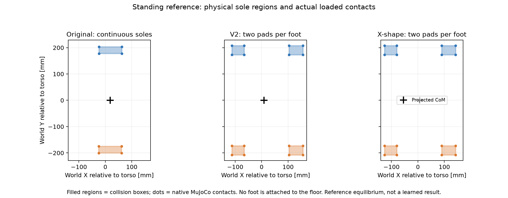

# STAND-03: three-model planted-standing comparison

9 November 2026, **13:48 CET**. **Full training submitted as array 3246822,
pending successful completion of GPU preflight array 3246816.** No training
steps have started at this check. Slurm's whole-array `afterok` dependency and
`--kill-on-invalid-dep=yes` prevent training after a failed preflight. The script
also independently requires all three passing validation JSON files.

| Training task | Model | Requested steps | Submission state |
|---|---|---:|---|
| `3246822_0` | V1 | 200M | Pending: preflight dependency |
| `3246822_1` | V2 | 200M | Pending: preflight dependency |
| `3246822_2` | X-shape | 200M | Pending: preflight dependency |

Up to three tasks may run concurrently, depending on SCITAS availability.
Preflight V1 completed (exit 0, 3m32 allocation), 16/16 fixed-PD trials survive
two seconds and both PPO updates are finite. V2 preflight is running; X-shape
is queued. [Exact scheduler receipt](submission-receipt.txt). No continuous
training monitoring is required; results remain in the isolated remote root.

User-approved task: fresh standing policies for original V1, V2 and X-shape;
one continuous V1 sole versus two separate V2/X-shape pads. Both feet remain
planted throughout this first campaign. Quiet standing precedes progressively
stronger mass-normalized torso pushes. Recovery steps are a later experiment.

| Model | Corrected mass | Collision regions / foot | Native reference contact points / foot | Left / right load |
|---|---:|---:|---:|---:|
| V1 | 14.356 kg | 1 continuous box | 4 | 70.681 / 70.152 N |
| V2 | 14.594154 kg | 2 separate boxes | 8 | 71.701 / 71.468 N |
| X-shape | 14.537322 kg (provisional) | 2 separate boxes | 8 | 71.436 / 71.175 N |

These loads are native-MuJoCo reference equilibria, not policy results.
The X-shape uses inclusive measured V2 properties on nine unchanged bodies;
six changed parts keep their new CAD COM/tensors with component density scaling.
The 1 kg torso allowance is added once. Motor/battery masses are not added twice.
X-shape sole detection accounts for the exported foot-frame rotation; assuming
its local -Z direction would select the wrong surface.

## Shared implementation

- New `stand_v1`, `stand_v2`, `stand_xshape` presets use identical reward weights,
  architecture, optimizer and sample budget. Each policy and optimizer starts fresh.
- Force-qualified contacts (2 N), actual contact-point slip, sole-level anchors,
  and actual loaded support hull replace incompatible body-origin measurements.
  V1 front/rear diagnostics partition one physical sole without duplicating force.
- Free base, six identical motors, unchanged motor limits/delay model, nominal
  friction 0.7, no springs, torso fixture, pitch reflex or loop-breaking jitter.
  V2/X-shape four-loop site mappings are explicitly validated.
- Quiet standing gets the strongest task term; torque, action changes, contact
  slip, footprint drift and missing flat support have separate logged costs.
  Walking-speed, swing, alternating-step and gait-clock rewards are absent.
- Whole-foot lift >3 mm for >50 ms or sole drift >20 mm ends a planted trial;
  a single pad temporarily unloading does not. Physical falls and step violations
  are logged separately. Timeout is not automatically a success.
- At least 200 quiet trials with >=95% success unlock 0.02 m/s-equivalent pushes.
  Pulses last 100 ms at the torso COM. After >=200 hard outcomes, >=90% recovery
  plus >=95% quiet success promotes by 10%; <70% retreats by 20%; cap 0.15 m/s.
  A successful recovery starts a continuous five-second quiet window within
  two seconds after the pulse. Pending outcomes are not counted as successes.
- Keep 20% no-push episodes. Sensor noise independently ramps over 20M steps
  after quiet unlock; physical domain randomization stays off. Legacy raw-angle
  symmetry loss is disabled equally on all models because motor signs differ.
- Fixed independent evaluation: 80 first-episode, 20 s trials, paired directions
  at 0 / 0.02 / 0.05 / 0.10 / 0.15 m/s, nominal plant and full sensor noise.
  The legacy JSON `survival` mapping contains **complete settled-task pass rates**
  in this mode; full-duration survival is separately logged.

## Validation and frozen source

Local: all six native-MuJoCo unit tests pass, Python compilation passes.
Loaded reference acceleration is <=0.000117 in all models. Contact force totals
match robot weight, hovering feet give no support, and slip follows the actual
contact point rather than the CAD body origin. No hidden base constraint.

SCITAS preflight array: **3246816**, indices `0=V1`, `1=V2`, `2=X-shape`.
Each task must pass the GPU probe, six native tests, two seconds fixed-PD MJX
standing (>=80% first-episode survival), and two finite PPO updates. Preflight
weights are discarded. Any failed gate prevents full training. The long array
is queued with a dependency so Codex need not remain active through the queue.

Remote root:
`/home/rizkalla/running_robot/experiments/stand03_20261109_v1`

[Source manifest](source-manifest.json), [runtime manifest](runtime-manifest.json),
[archive receipt](packaging.json). Archive SHA-256:
`b799fd8edc2073a54e9770e5f1ec59e2b5ffdd7312aa31f54ca67b6d61017aa2`.
The frozen snapshot contains the review-stage plan; this status file records
subsequent validation and submission. Training scripts verify all frozen source,
model and mesh hashes before execution.

## Training contract

200,000,000 steps **per model**, seed 0, one GPU each, up to three concurrent
tasks. 512 environments x 36 ticks/update; 4 PPO epochs; 100 Hz control, 1 kHz
physics. Save every 110 updates, evaluate every 400. 24 h scheduler limit,
22.5 h training cutoff to reserve time for checkpoint/final evaluation.
`completion.json` reports actual steps and step/time completion reason.

These are exploratory single-seed runs. No learned standing, perturbation
robustness, hardware performance or design superiority is established yet.
