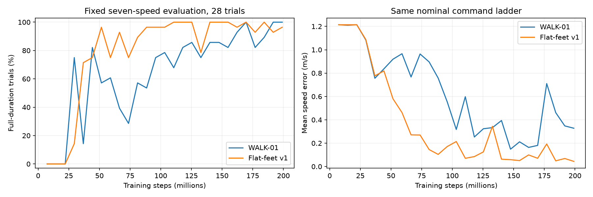
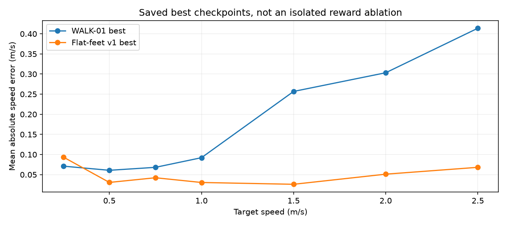
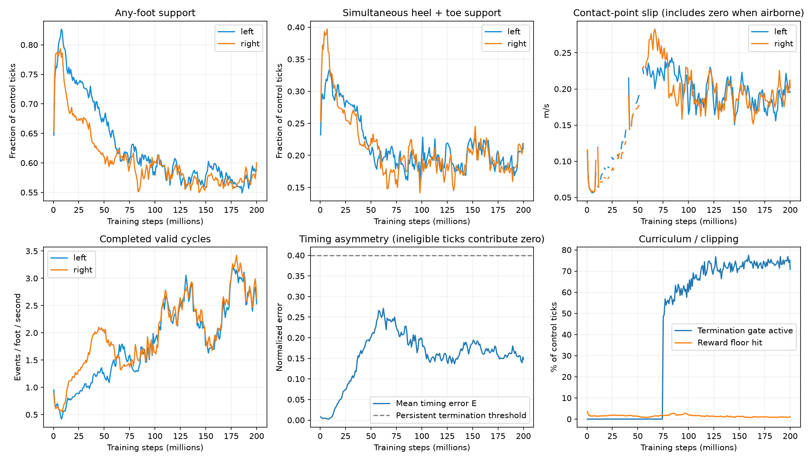
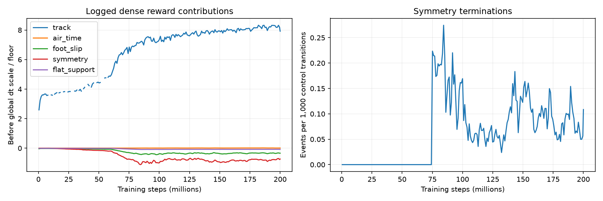

# DASH-01 flat-feet symmetry v1

Prepared 2026-10-20 (client date). Latest user specification supersedes the earlier
four-arm diagnostic experiment request: implement one focused adaptation, submit
200M steps, and stop Codex after submission. No training monitoring is requested.

## Completed results

**Job 3226505 completed normally: 200,005,632 steps in 12h54m12s, exit 0:0.**
The GPU smoke test passed, including one-time symmetry termination/autoreset and
both finite PPO updates. No new training was launched during this results review.

[Videos and graphs](../report/flatfeet-videos.html) compare the best and final policies.
The nominal MJX replay job **3226907 completed in 4m18s**, exit 0:0.
Six two-view clips show best/final at 0.25, 0.75 and 1.5 m/s, with slow-motion controls.

| Evaluation | Checkpoint | Full-duration trials | Mean speed error |
|---|---:|---:|---:|
| WALK-01 saved best | 169.57M | 28/28 | 0.181 m/s |
| Flat-feet v1 saved best | 184.32M | 28/28 | 0.049 m/s |
| Flat-feet v1 last periodic evaluation | 199.07M | 27/28 | 0.044 m/s |

The last periodic evaluation records one physical fall. The separate **final
checkpoint** command-redraw evaluation records no physical falls, but only 26/28
trials reach 30 seconds; two end at 15.36 and 11.58 seconds. Its old evaluator
omits the symmetry reason and calls non-finishes timeouts in its printed text.
Given this frozen environment's termination branches, the two early non-fall
endings are consistent with symmetry termination, not successful 30-second trials.
Its `track_err` field measures red-light tracking and is zero because STOP is off;
use the fixed-ladder evaluations for walking speed error instead.

During the last 100 logged training updates (198.18-200.01M steps), average
whole-foot support is L/R **58.7% / 58.1%**, and simultaneous heel/toe support is
**21.2% / 20.6%** of all ticks. Valid completed cycles average **2.75 / 2.90 per
foot per second**. These aggregates indicate closer bilateral use but do not prove
that every individual episode has clean alternating steps. Mean timing error E
is **0.147**, with zero contributions before eligibility; the termination gate
is active on **74.6%** of control transitions.

Contact-point slip still averages **0.197 / 0.204 m/s** over all ticks, including
zero while airborne. This remains a concern. Flat-support percentages here cover
all gait phases and should not be interpreted as the mid-stance success rate.
The clock remains at its 4 Hz upper bound. About **0.99%** of recent reward steps
hit the dense reward floor. Symmetry terminations occur on **0.0054%** of control
transitions; that is not an episode failure percentage.

### Replay findings: speed tracking has improved, but gait quality is not solved

One nominal trial per condition, seed 1000, 25-second cap. Counts below are valid
completed whole-foot cycles **after the first 5 seconds**, not all contact changes.

| Checkpoint | Target | Achieved speed after 5 s | Valid cycles L/R | Outcome |
|---|---:|---:|---:|---|
| Best 184.32M | 0.25 | 0.344 m/s | 78 / 80 | 25 s completed |
| Best 184.32M | 0.75 | 0.787 m/s | 1 / 80 | 25 s completed |
| Best 184.32M | 1.50 | 1.483 m/s | 80 / 80 | 25 s completed |
| Final 200.01M | 0.25 | 0.298 m/s | 36 / 60 | 25 s completed |
| Final 200.01M | 0.75 | 0.721 m/s | 77 / 68 | 25 s completed |
| Final 200.01M | 1.50 | 1.501 m/s | 54 / 36 | Symmetry termination at 19.22 s |

**Confirmed monitoring blind spot:** the best 0.75 m/s trial passes despite
strongly unequal valid-cycle counts. During its 5-25 s window, the left foot's
contact signal has 183 complete stance and 183 swing bouts; 56% of each are
shorter than the 0.04 s validity threshold. Longest stance is only 0.14 s.
These are force-threshold contact events, not necessarily distinct physical steps.
The symmetry comparison advances only when both feet produce new valid cycles;
short invalid phases can leave its comparison history stale. Meanwhile, every
brief liftoff resets the continuous planted-leg timer, so that fallback does not
catch this pattern. This explains why low logged timing error is insufficient to
certify bilateral stepping. It does not establish that the left motor is inactive.

The final 0.75 m/s trial has more balanced valid-cycle counts. Its 1.5 m/s trial
terminates under the symmetry rule, so speed accuracy alone should not select it.
The next experiment should first review contact-event debouncing and stale step
history detection, with explicit tests for repeated short contact interruptions.
No such reward/controller changes or further training were made in this review.

Early training slip curves contain gaps: 31 updates per side have nonfinite slip
values between 9.49M and 56.99M steps; logged mean rewards remain finite. Gaps are
preserved rather than interpolated. Recent metrics and replay traces are retained
for review in the numerical summary and NPZ files.

The comparison uses the same nominal ladder but is **not a controlled ablation**:
contact handling, flat-support and symmetry changed together, and only one seed
was trained. Tracking improved substantially; clean walking still requires visual
assessment. Raw CSV/JSON metrics and generated summary are retained in the
[experiment directory](experiments/dash01_flatfeet_symmetry_v1/).

## Experiment contract

- Experiment: `dash01_flatfeet_symmetry_v1`.
- Preset: `cad_v2_flatfeet_symmetry_v1`; run `dash01_flatfeet_symmetry_v1_s0`, seed 0.
- Fresh actor, critic, optimizer and observation statistics. WALK-01 weights/results
  remain intact. This is a fresh run, not a continuation of the asymmetric policy.
- 200,000,000 environment steps; existing 24-hour allocation and 10-minute save
  reserve. Whichever limit arrives first ends training and saves a checkpoint.
- Calibrated CAD-v2 homing model, unchanged six motors, gait generator, network,
  PPO settings, command curriculum, domain randomization and observation widths.
- Same 512 environments x 36 ticks, four PPO epochs. Checkpoints every 2M steps,
  periodic evaluation every 400 rollouts, existing best/final checkpointing.
- One GPU, 10 CPUs, 90 GB, established `dash-v2` SCITAS environment.

## Changes and numerical meaning

`two_point_feet` defaults off, preserving all historical preset behavior.
The new preset enables it, `symmetry_enable`, and `flat_support_enable`, and sets
the original `w_foot_flat` to zero. Other reward weights are unchanged.

1. **Actual support:** per-pad normal force >=2 N, active foot/floor contact and
   nonpositive contact distance. Toe OR heel defines the whole-foot grounded state.
   Toe AND heel defines flat support. The near-floor `grounded_h` fallback and
   union of contacts from earlier physics substeps are not used for this preset's
   event timing. A heel-to-toe transition does not become a touchdown/liftoff.
2. **Slip:** velocity at actual ground-contact points, projected into each
   contact's tangent plane, aggregated by normal-force-weighted RMS within each
   foot. Additional toe/heel points do not multiply the penalty. The old weight
   4.0, 0.05 m/s deadband and penalty cap remain. Its measured numerical scale may
   differ from toe-origin displacement; no silent coefficient change was made.
3. **Clearance:** existing lowest-corner calculation over both oriented pads;
   existing clearance and air-time rewards now use actual whole-foot swing.
4. **Mid-stance flat support:** separate `flat_support` cost, maximum magnitude
   0.25 before the existing shaping/dt scales, averaged over the two feet.
   A scheduled stance foot missing either pad is penalized only between fractions
   0.20 and 0.80 of its stance phase. Both percentages are configurable. No cost
   in swing or the first/last 20% of stance; no positive planted-foot bonus.
   Single-pad loss never directly terminates an episode.
5. **Completed-cycle symmetry:** each valid cycle ends at touchdown after at
   least 0.04 s of swing and a preceding stance of at least 0.04 s. Track the last
   three completed cycles per foot. After two cycles per foot, compute
   `E = 0.5 * (abs(stanceL-stanceR)/mean(stanceL,stanceR)
              + abs(swingL-swingR)/mean(swingL,swingR))`.
   Denominators have a 0.04 s floor. E ranges from 0 to 2; threshold 0.40 is a
   mean relative timing mismatch, not 40% instantaneous joint-angle difference.
   Dense cost `-5 * E` is scaled by the existing shaping curriculum. No new
   step-length or instantaneous left/right posture penalty is introduced.
6. **Persistent termination:** after 5 s of uninterrupted walking and existing
   `shape_scale >= 0.65`, terminate after two consecutive new paired comparisons
   exceed E=0.40. Both feet must contribute a new completed cycle to each new
   comparison; repeatedly reading the same window cannot accumulate evidence.
   Minimum two completed cycles per foot remains mandatory for this condition.
7. **Planted-leg exception:** after 8 s walking, 2 s of continuous forward motion
   >=0.10 m/s, one foot grounded >=2.5 s, and the other >=4 completed cycles ahead,
   charge at least E=1 and allow termination behind the same curriculum gate.
   This explicitly covers a foot that never completes its first two steps.
8. **Grace and terminal accounting:** symmetry is disabled below 0.05 m/s command
   or during STOP. Pushes, active trips and new gusts suspend it for a configurable
   two-second recovery interval and clear old step evidence. A symmetry terminal
   event costs -10 once, outside the dense reward floor and dt scale; a coincident
   physical fall uses the existing fall penalty instead. Auto-reset is unchanged.
   True termination does not bootstrap as a timeout even if both coincide.

The normal dense reward floor remains unchanged. `reward_terms/symmetry`,
`reward_terms/flat_support`, and `reward_terms/symmetry_terminal` are separate CSV
columns. Per-foot support, slip, completed phases, timing error, curriculum gate,
planted-leg detection, termination fraction and floor fraction are also logged.

## Initial evidence, not a completed causal diagnosis

WALK-01 final is 200,005,632 steps, SHA256
`a94c8a8b84584f1af459798d38b262ba98659dd0ab1d4ed26288b4492a77fab1`.
Best is 169,574,400 steps. Its nominal 0.75 m/s MJX trace shows cam motion ranges
L/R approximately 6/17 degrees and thigh ranges 9/21 degrees. Both legs move;
the left moves substantially less. No right-leg-only reward index was identified:
the old slip, air-time and clearance terms sum both feet, and motor costs cover six
actuators. The old `duty_sym` is a minimum-contact-duty penalty, not equality of
left/right timing. `w_swing_floor=0`; bilateral step rewards are disabled in WALK-01.
The generator permits different amplitudes via `1+s` and `1-s`. These are incentive
and architecture observations, not proof of a mechanical cause. No motor fault or
full geometric mirror equivalence has been established. The earlier detailed
diagnostic replay job 3226325 is independent; it does not train or mutate weights.

Nathann's motor usage tool is `RLframework/tools/torque_vs_speed.py`, and the old
static force-capability map is `sprint_runner/walk_mit/model/plot_force_map.py`.
That old map assumes the previous linkage/passive ankle and must not be presented
as a validated capability map for CAD-v2's Achilles linkage.

## Validation and submission

Local: 16 tests pass (`test_flatfeet`, `test_walk_reproduction`,
`test_walltime_budget`), plus Python syntax checks. Contact-point velocity is
checked against MuJoCo's point Jacobian on the new model. Synthetic tests cover
toe-only, heel-only, flat, no contact, hovering, force noise, rollover, slip
normalization, symmetric alternating cycles, persistence, the planted-leg case,
startup/curriculum/recovery exemptions, and configurable mid-stance boundaries.

GPU checks are an automatic prerequisite **inside the submitted allocation**,
not reported as already passed locally: `flatfeet_preflight.py` tests the actual
MJX environment, the one-time terminal bill and auto-reset, then two finite PPO
updates (16x8, one epoch only for the smoke). A failed check aborts before training.
The long run receives a new agent with the unchanged training settings.

Frozen source manifest and exact configuration:
`docs/experiments/dash01_flatfeet_symmetry_v1/`.
Launcher: `RLframework/slurm/izar_cad_v2_flatfeet_symmetry_v1.sbatch`.
Remote root: `/home/rizkalla/running_robot/experiments/dash01_flatfeet_symmetry_v1`.
Logs: `RLframework/logs/flatfeet-symmetry-v1-JOBID.out`.
Checkpoints and CSVs: `RLframework/runs/dash01_flatfeet_symmetry_v1_s0/`.
Submission receipt is written by the submission command to `submission.txt`.

Results are recorded above; no additional training or reward changes were made during review.
