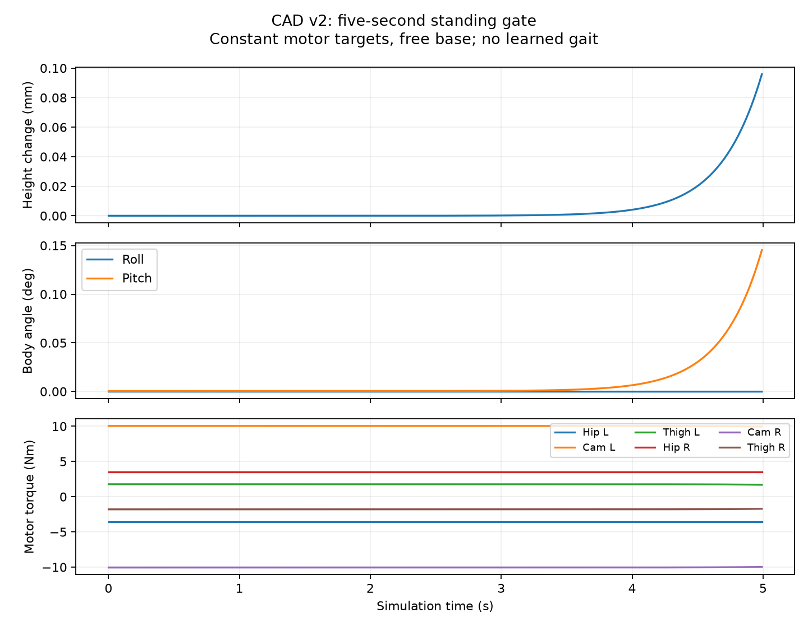

# GAIT-01 — first gait training on the articulated-foot CAD

Date: **14 October 2026**. Branch: `dash-01-v2`.

## Objective and approved sequence

Find repeatable walking on the revised robot, then extend the speed envelope.
The approved sequence is physical plant validation, low-speed PPO, progressive
speed increases, repeated gait evaluation and report/video collection. Startup,
perturbation recovery and stopping remain later stages of the Robotics Day demo.
The user clarified on 14 October: **focus on walking now, with no separate
standing/balance training phase**. A hardware homing position will be supplied
later. The current equilibrium is only a simulation reset, not a validated
homing position. Balance during motion remains part of the walking task.
“Optimal” means best found under explicit feasibility/evaluation criteria; this
pilot cannot establish a global optimum or a hardware maximum speed.

## Current submission

- SCITAS job **3219542**, submitted 14 October 2026: **COMPLETED**, exit 0, in 27 min 19 s.
- Isolated directory: `/home/rizkalla/running_robot/experiments/gait01_20261014_v2`.
- Preset `cad_v2_gait01`; new randomly initialized policy, seed 0.
- Up to **5,000,000 environment steps**, 512 environments, 32 ticks per rollout.
  The trainer can finish at the next complete rollout boundary.
- One GPU, 10 CPUs, 90 GB RAM, four-hour job limit.
- Commands **0.2–0.5 m/s**; 100 Hz control, 1 kHz physics.
- Automatic sequence: matched CPU/MJX physics check, throughput/finite-PPO benchmark,
  training. `set -e` stops the job if any preceding gate fails.
- Final progress: **5,013,504 steps**, rounded to a complete rollout; final checkpoint saved.

The numerical comparison and finite-PPO benchmark passed. The latest evaluation
at 4,194,304 steps still has **96 falls in 96 trials**, so no successful gait is
demonstrated. Final training episode duration is about 2.20 s (initially 0.23 s),
with sampled flight fraction about 6.3%. These are learning metrics,
not proof of walking. Downloaded records and current status are in
[the v2 snapshot](experiments/gait01_20261014_v2/STATUS.md).
The user approved [GAIT-02](gait02-experiment-report.md), a longer stage from a
comparison of the best and final pilot checkpoints. The final policy was not
periodically evaluated at exactly its saved step, so it needs that comparison.

Source hashes: [v2 execution manifest](experiments/gait01_20261014_v2/source-manifest.json).
The 35-file, 2.85 MB execution bundle contains required Python code, generated
plant, 15 meshes, submission script, GPU check and manifest. An initial broad
archive was rejected by automatic upload review and was **not transferred**.
The reduced bundle was approved and all 34 payload hashes verified remotely.
It excludes the PDF, raw CAD XML, historical policies and unrelated artifacts.

## Hardware assumptions confirmed by the user

- All six motors are unchanged from the previous robot.
- Achilles links are rigid: **no spring**.
- PDF body/hip masses include motors and battery; PDF frames match export frames.
- The added torso allowance remains 1 kg, giving total mass **14.594154 kg**.

Motor torque/gain/delay/back-EMF parameters are reused from the existing pipeline.
Reflected armature and joint damping are inherited modeling assumptions, not new
measurements. Ground friction is provisionally 0.7. Motor homing is not calibrated
for deployment: all joint coordinates remain relative to the CAD export.

## Plant implementation

Builder: [`make_cad_v2_plant.py`](../RLframework/model/make_cad_v2_plant.py).
Output: [`dash01_cad_v2_free.xml`](../RLframework/model/dash01_cad_v2_free.xml).
Audit: [`plant_audit.json`](../dash-01CAD-v2/generated/plant_audit.json).

The plant has six base coordinates, 14 leg hinges, six actuators and four connect
equalities. Passive ankles and Achilles links are retained. The existing plant
loader now includes all eight closure sites in its linkage-site bookkeeping.

The sole is angled in the CAD foot frame. Its two largest coplanar rectangular
bottom patches are identified from triangles and used as separate heel/toe
collision boxes. Each is 35 mm wide and roughly 47/53 mm long. Boxes extend
2 mm **into** the foot; no unmeasured pad thickness is added below the sole, and
the arch gap is not filled. Visual meshes have collision disabled; foot/ground
contacts are modeled. Detailed body/self-collision remains outside this pilot.

Existing CAD joint limits are preserved. The unlimited exported cam joints get
a provisional **±0.6 rad about the exported pose** exploration guard. This is
not a verified hardware travel range; it must be revisited before measuring a
physical speed limit. Original raw and corrected inspection CAD remain intact.

## Standing reset and diagnostic finding

The pose solver closes all four loops, lays the soles flat at equal height and
centres the COM fore-aft over the support area. Nominal torso height is about
**0.862 m**. The earlier high-gain settling method sampled a moving state and
its derived low-gain command tipped the new robot by 30° after approximately
1.39 seconds. That initialization was rejected.

A static gravity/contact equilibrium solve instead finds the six holding torques
and the slight contact/linkage deflections. The desired command is then
`q_equilibrium + torque / Kp`. No torso support force is added. The optimizer
reached its 700-evaluation budget; the accepted endpoint passed the physical
residual check (maximum acceleration below 1e-7) and subsequent simulation.

Classic MuJoCo five-second validation, nominal Kp/Kd and motor limits:

| Measure | Result |
|---|---:|
| Peak body tilt | 0.150° |
| Horizontal drift | 1.93 mm |
| Final base speed | 0.00621 m/s |
| Peak motor torque | 10.052 Nm |
| Maximum loop gap | 3.48 micrometres |
| Torque saturation / simulator warnings | 0 / 0 |

The 16-iteration / 8-line-search CPU solver cap also passed a five-second hold.
These checks concern an exact nominal reset, not disturbance recovery or learned
standing. **The exact-reset test does not establish stable balance.**

The first GPU job **3219514 failed after 1 min 48 s**, before any PPO training.
Its zero-action rollout fell at approximately 4.97 s, with peak tilt 55.67° and
maximum horizontal drift 0.701 m. Values remained finite and the final loop gap
was 3.44 micrometres. That final gap was measured after automatic reset, so it
does not establish linkage quality throughout the fall. The full failure is
preserved in [the original GPU result](experiments/gait01_20261014_v1/gpu-standing.json).

Local diagnosis reproduced the instability: a 0.0001 rad initial pitch offset
led to 30° tilt at 2.83 s. Increasing proportional gains up to 2.5 times their
baseline delayed that threshold to 3.70 s but did not stabilize it. Five reset
poses with fore-aft COM offsets from -6 to +6 cm also failed this perturbed test
([stance scan](experiments/gait01_20261014_v1/stance-search.json)). Those gains
and alternative poses were diagnostic only; the training plant is unchanged.
The builder now records both nominal and perturbed holds in its audit.

**Decision for v2:** fixed-target standing is a controller capability, not a
prerequisite for learning walking. Following the user's walking-first direction,
no balance controller or standing curriculum is added. The replacement numerical
gate compares classic MuJoCo and MJX over one second at identical model fields,
motor limits and fixed targets, for pitch offsets 0 and ±0.001 rad. It requires
finite states, maximum coordinate error <0.005 (metres/radians) and velocity
error <0.05 (m/s or rad/s). The five-second zero-action result remains explicitly
reported as `standing_passed`; it is not relabeled successful. A finite PPO
update benchmark must also pass before training. This tests numerical consistency,
not whether the eventual gait will work.

Local regression suite: **45 tests run, 42 passed, three JAX-dependent tests
skipped** because local JAX is not installed. GPU execution is checked on SCITAS.

## Learning setup

Reuse the 41-parameter periodic gait specification plus six rapid residual
corrections. Train new weights rather than transplanting the old robot policy.
The first command range is 0.2–0.5 m/s, cadence range 0.5–2.5 Hz. Motion amplitudes
are reduced for initial exploration. Exact mirror-symmetry loss is disabled
because the supplied inertials and joint limits are not exactly symmetric.

The inherited tracking reward is centred on requested speed. The former
monotonic speed-income term is disabled for this pilot. A new flight penalty
uses the fraction of **1 ms substeps** where neither heel nor toe of either foot
touches the ground; it does not use the permissive near-ground height heuristic.
The penalty encourages walking but does not certify the resulting gait. Training
logs record flight fraction and forward speed alongside reward and survival.

No stop commands, pushes, sensor noise or plant randomization in this first pilot.
Joint-reset noise is zero to avoid independently perturbing 14 coordinates and
breaking the four closed loops. This deliberately starts from a narrow reset
distribution. Later robustness tests must introduce physically consistent
perturbations. Thermal dynamics remain active, with a cold initial state.

In-training evaluation uses 0.2, 0.35 and 0.5 m/s, 25 seconds total, excluding the
first five seconds from tracking means. There are 32 nominal replicas per speed;
without reset/plant noise these are not independent robustness trials. The
inherited keeper score measures tracking/falls/heading, not a certification of
walking contact patterns. Dedicated contact/video evaluation is required before
declaring a successful gait or increasing the speed envelope.

## Acceptance before extending speed

The approved target is at least 29/32 successes over 20 measured seconds after
five seconds of settling, with mean speed error within max(0.1 m/s, 15%), walking
contacts, controlled heading, no falls and feasible actuator/joint loads. Use
fresh, meaningfully varied initial conditions for that test. Nominal maximum
and robust operating speed will be reported separately. Begin speed increments
around 0.2 m/s only after low-speed walking passes; narrow increments near failure.

## Evidence and commands

[CPU nominal-reset video](../report/videos/cad_v2_standing_gate.mp4) — five seconds,
normal speed, fixed motor targets; **not a learned gait or stable balance**.
The tiny drift in this exact-equilibrium clip masks the instability described above.



```powershell
.\.venv\Scripts\python.exe RLframework/model/make_cad_v2_plant.py
.\.venv\Scripts\python.exe -m unittest discover -s RLframework/tests -q
.\.venv\Scripts\python.exe report/scripts/build_gait01_assets.py
```

On SCITAS:

```bash
squeue -j 3219542
tail -f /home/rizkalla/running_robot/experiments/gait01_20261014_v2/RLframework/logs/cad-v2-gait01-3219542.out
```

GPU results belong under `validation/`; policy/checkpoints and progress under
`RLframework/runs/cad_v2_gait01_s0/`. Preserve this first source snapshot when
changing the next experiment. A passing pilot is the start of the gait search,
not evidence yet of the robot's maximum speed.
