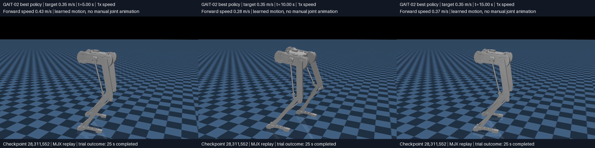

# GAIT-02 — longer walking training on CAD v2

Date: 14 October 2026. Branch: `dash-01-v2`.

## Results checked 15 October 2026

**Video review correction:** the user identified right-foot dragging and mainly
left-leg stepping. Kinematic clearance measurements confirm a strong imbalance.
GAIT-02 is therefore **not accepted as a walking gait**, despite improved
survival and forward speed. See [the proposed symmetry revision](gait03-symmetry-plan.md).

Job **3219597 completed**, exit 0, in **2 h 23 min 48 s**, with **30,015,488**
new training steps. Selection chose the pilot's final checkpoint (5,013,504
steps) because both candidates tied the keeper score but its mean survival was
2.06 s versus 1.21 s. The resulting lineage totals 35,028,992 environment steps.

Best checkpoint: **28,311,552 new-stage steps**. It survived **72/96 full
25-second trials (75%)**, versus 0/96 in the pilot's periodic evaluations.
Mean absolute speed error was **0.123 m/s** and heading error **9.35°**.

| Command | Survived full 25 s | Mean absolute speed error after warm-up |
|---|---:|---:|
| 0.20 m/s | 25/32 | 0.124 m/s |
| 0.35 m/s | 32/32 | 0.058 m/s |
| 0.50 m/s | 15/32 | 0.186 m/s |

This is clear improvement in nominal simulation, strongest at the middle target.
It does not establish robust walking across the speed range. The trials are
nominal replicas, and the keeper does not certify walking-only contacts. Last
sampled training flight fraction was **3.44%**, so contact traces/video need
inspection before claiming a walking gait. That sampled value does not directly
measure the saved best policy.

The last periodic evaluation (29,360,128 steps) regressed to about **60%**
full-episode survival; keep `best.msgpack` for the next replay/comparison. The
final checkpoint was saved after that evaluation and is not separately evaluated
at its exact final step. The log's `bring-up` block had bring-up randomization
disabled for this preset; its 93% result is not evidence of startup/homing ability.
No new training job was submitted during this check.

Metrics and checkpoint provenance are saved in the
[experiment snapshot](experiments/gait02_20261014_v1/STATUS.md).

## Objective and submission

In practical terms, this was a **low-speed gait discovery stage**: learn joint
motions that move the revised robot forward at commanded speeds while avoiding
falls and discouraging flight. It was not yet the maximum-speed search or the
startup/STOP demo. Survival and tracking are progress indicators; replay and
contact inspection are needed to decide whether the resulting movement is a
usable walking gait. Training saved metrics and checkpoints, not automatic videos.

## Video replay — 15 October 2026

Replay job **3219901** completed in 3m03s. Three fresh nominal greedy trials use
the best checkpoint (28,311,552), seed 1000 and constant targets. Every trial is
retained, including the failure. These are additional illustrative trials, not
the original 96-trial evaluation or a selected best-of-many sample.

| Video, real-time playback | Duration / outcome | Mean forward speed after 5 s | Flight fraction |
|---|---|---:|---:|
| [0.20 m/s target](../report/videos/gait02_best_0.20mps.mp4) | 25 s, no fall | 0.255 m/s | 2.27% |
| [0.35 m/s target](../report/videos/gait02_best_0.35mps.mp4) | 25 s, no fall | 0.333 m/s | 3.41% |
| [0.50 m/s target](../report/videos/gait02_best_0.50mps.mp4) | Fall at 20.31 s | 0.377 m/s | 4.61% |

Flight fraction is measured over the recorded episode at 1 ms physics substeps:
neither heel nor toe of either foot contacts the ground. Nonzero flight means
strict continuous-ground-contact walking has not been achieved in these trials.
Survival/forward motion therefore should not be conflated with an accepted walking
gait. The high-speed trial both undershoots its command and eventually falls.

Videos render recorded MJX poses with classic MuJoCo; they do not rerun physics
or animate a manually authored trajectory. The camera follows the torso. Videos
end at the first termination and never show a reset as continued survival.
The last rendered pose precedes the terminating step; the fall is detected by
the environment, without waiting for the body to hit the floor.

Recorder/renderer: `RLframework/tools/gait_video.py`. Numerical results and
checkpoint SHA-256: [replay metadata](experiments/gait02_20261014_v1/best_gait_trace.json).
The raw `best_gait_trace.npz` is retained locally and on SCITAS.



The user approved a longer run to let the existing walking objective learn on
the new robot. Train **30 million additional environment steps** from a selected
GAIT-01 checkpoint. No separate homing, standing or stopping phase is included.
The user will provide a known homing pose later.

SCITAS job **3219597**, submitted with one GPU, 10 CPUs, 90 GB RAM and a
**six-hour wall limit**. Remote snapshot:
`/home/rizkalla/running_robot/experiments/gait02_20261014_v1`.
The allocation limit is not a prediction of training duration. Pilot throughput
suggests roughly two hours plus evaluation/setup overhead; evaluation can take
longer as policies survive longer. Queue time is separate.

## What is preserved and what changes

Same reviewed 14.594154 kg plant, articulated feet, four rigid linkage loops,
six motors, 100 Hz control, 1 kHz physics, 512 environments and 32-tick rollouts.
Same 0.2–0.5 m/s commands, 0.5–2.5 Hz cadence range, action bounds, reward formulas,
reward coefficients, fall conditions and nominal reset as GAIT-01. No reward
retuning is introduced. These are the **GAIT-01** settings, including its flight
penalty, not an assertion that the preset is identical to the old robot's.

Changes are limited to budget, schedule lengths and checkpoint initialization:

| Setting | GAIT-01 | GAIT-02 |
|---|---:|---:|
| New training budget | 5M steps | 30M steps |
| Shaping-weight ramp | 5M | 30M |
| Efficiency-weight ramp | 5M | 30M |
| Entropy hard deadline, after budget scaling | 2M | 12M |
| Entropy anneal length, after budget scaling | 2.5M | 15M |
| Initial weights | Random | Selected pilot checkpoint |

This uses the existing **warm-start** path: policy/critic/estimator weights and
observation statistics are copied, while optimizer, step counter, learning-rate
schedule and curriculum restart. Learned action standard deviations are retained;
observation count and variance are not capped or modified on loading. The longer
entropy schedule permits continued exploration but does not forcibly reset noise.
Shaping restarts at 0.15 and efficiency at its configured initial level, reaching
the same final weights over the longer budget. Therefore this tests a longer
training stage with restarted schedules, not duration alone with identical
optimizer history. Source steps plus 30M gives the selected policy's lineage
exposure; the new progress log starts at zero.

## Checkpoint selection

The pilot completed as job **3219542**, exit 0, in **27 min 19 s**. It did not
demonstrate sustained walking. The last periodic evaluation had 96/96 falls;
the final checkpoint was saved after that evaluation and needs its own comparison.

`select_gait_checkpoint.py` evaluates the pilot's `best.msgpack` and
`final.msgpack` on the same 0.2/0.35/0.5 m/s ladder, seed and 25-second horizon.
It uses 12 nominal replicas (four per speed), not independent robustness trials.
The existing tracking/fall/heading score ranks candidates; mean episode duration
breaks ties, then latest step. This matters because all pre-five-second falls
receive the same fallback tracking error, so `best` remained at step 1,048,576.
No candidate is described as a successful gait solely because it is selected.

The selected file is copied to `inputs/selected.msgpack`, with its SHA-256 and
comparison results in `inputs/selection.json`. Selection failure prevents
training. The completed pilot and its checkpoints remain untouched.

## Monitoring and evidence

The existing trainer evaluates approximately every 1.05M steps and saves periodic
checkpoints approximately every 1M, plus best/final checkpoints. Monitor survival,
speed tracking, actual flight fraction, gait frequency and videos before raising
the speed target. The inherited best-checkpoint score does not certify walking
contacts. All 96 training evaluation replicas use nominal conditions.

The plant and physics code are unchanged from the passing GAIT-01 CPU/MJX
comparison and finite-update benchmark. Local checks verified that only the six
documented config fields differ, compiled the selection script, and checked the
Slurm shell syntax remotely. All 34 payload hashes were verified before submission.
No PDF, raw CAD XML or unrelated historical artifacts were uploaded.

This submission is **one bounded 30M run**, not an unlimited chain of jobs.

- [Status](experiments/gait02_20261014_v1/STATUS.md)
- [Frozen source manifest](experiments/gait02_20261014_v1/source-manifest.json)
- [Pilot findings](gait01-experiment-report.md)

```bash
squeue -j 3219597
tail -f /home/rizkalla/running_robot/experiments/gait02_20261014_v1/RLframework/logs/cad-v2-gait02-3219597.out
```
