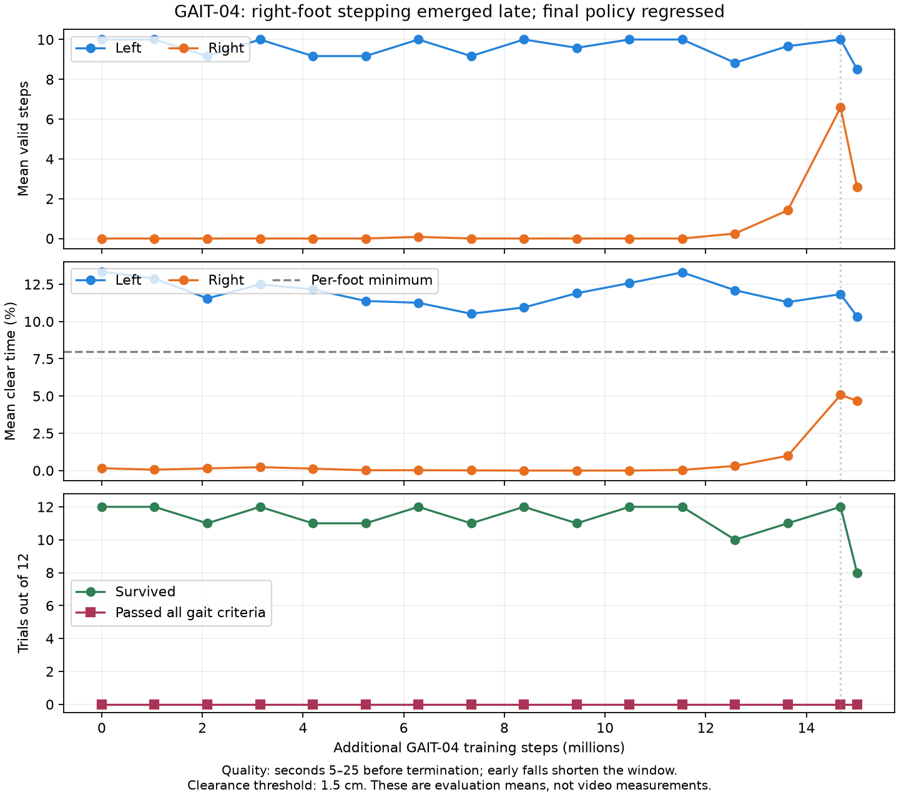

# GAIT-04: stronger swing penalties and incremental bilateral progress

15 October 2026. User approved a medium-length continuation to test whether the
revised objective and additional training time can resolve right-foot dragging.
Snapshot: `gait04_20261015_v1`, SCITAS job **3220118**. Submission status is recorded in
[STATUS.md](experiments/gait04_20261015_v1/STATUS.md).

## Baseline and hypothesis

GAIT-03 completed 5,013,504 steps. Final evaluation: 12/12 survived, speed error
0.03574 m/s, but every trial had ten valid left steps and zero right steps after
warmup. Mean right clear time was 0.217%, flight 3.42%. No trial met gait criteria.
Its final diagnostic candidate is the warm-start here, not an accepted gait.

The hypothesis is that stronger expected-swing contact costs and continuous
progress credit make partial right-foot swings worth discovering, before the
policy can satisfy the complete valid-step definition. The previous weaker-foot
penalty was near saturation, while alternating-step credit remained zero.
This experiment changes both rewards and budget; it cannot independently prove
that extra time alone would have fixed GAIT-03.

## Reward changes relative to GAIT-03

Only the new `cad_v2_gait04` preset enables `bilateral_progress_enable`.
GAIT-03 reward behavior remains available for replay and comparison.

| Term | GAIT-03 | GAIT-04 |
|---|---|---|
| Expected-swing grounded cost | −0.5 × mean swing-weighted contact | **−2.0** × same quantity |
| Expected-stance airborne cost | −0.5 × mean stance-weighted air | Unchanged |
| Weaker-foot clear-time deficit | −0.4 × normalized squared deficit | **−1.0** × same deficit |
| Missing-step cost | −0.2 × mean age deficit | **−0.6** × mean age deficit |
| Cycle asymmetry cost | Zero without bilateral valid-step history | −0.3 × maximum of available cycle cost and missing-step deficit |
| Partial lift credit | None | +0.6 × mean swing-weighted airborne clearance fraction, capped at 1.5 cm |
| Forward-reach progress | None | +0.6 × mean new forward-reach progress, weighted by partial lift and swing phase |
| Weaker-leg progress credit | None | +0.5 × normalized minimum left/right lift-quality EMA, capped at 1 |

Expected phase uses the existing raised-cosine contact transitions and 65%
stance ratio, with sides half a cycle apart. There is no hard contact switch
at a phase boundary, and double support remains possible. Partial lift credit
is continuous in height once the foot is airborne; it does not measure unloading
force while contact persists. Contact state retains its two-tick debounce.

Forward reach is measured relative to the torso from actual liftoff, capped at
4 cm. Only increases beyond the greatest reach already achieved in that airborne
bout earn progress. The per-tick increase in normalized reach is multiplied by
0.4 s / control timestep and capped at 1 before clearance/phase weighting.
Repeated back-and-forth travel cannot repeatedly earn credit for the same reach.
Weaker-leg progress uses a 1 s EMA of swing-weighted airborne clearance fraction,
normalized by 0.15. It therefore provides graded credit below full valid-step
clearance; improving only the stronger foot cannot increase this pair credit.

Missing-step costs retain the existing three-second grace and saturate at six
seconds without a valid step. Their inclusion in the cycle-cost term is an
explicit additional missing-history cost, not a claim that unmeasured cycles
have a known asymmetry. Alternating touchdown credit, valid-step thresholds,
slip cost, speed tracking, physical constraints and flight penalty are unchanged.

## Training and evaluation

- **15M additional steps**, fixed target **0.35 m/s**, seed 0, 512 environments.
- Warm-start GAIT-03 `final.msgpack` at 5,013,504 stage steps. Policy parameters,
  learned action standard deviation and observation statistics are retained;
  optimizer, step count and schedules restart.
- Source SHA-256:
  `65cff0cda55d4b8fc547ad40585fcf7b3a77c1cb7e327826c70c56d90595f439`.
- Shaping ramps from 0.5 to 1 over 3M steps; approximately 12M steps remain at
  full weight. Learning rate 5e-5 to 1e-5 with 100-update warmup; inherited
  entropy scheduling scales to the 15M budget.
- Baseline, evaluations every 64 rollouts (1,048,576 steps), and final evaluation.
  Compare right steps, clearance, alternation, survival and reward-floor clipping
  across training, especially around 5M, 10M and 15M.
- Acceptance is unchanged from [GAIT-03](gait03-experiment-report.md): at least
  11/12 nominal 25 s trials must pass the full gait criteria. Diagnostic candidates
  remain explicitly separate from qualified keepers.
- One GPU, 10 CPUs, 90 GB RAM, four-hour wall-time cap. Based on GAIT-03,
  roughly 1.5–2 hours execution is an estimate, excluding queue time.

No model geometry, inertias, actuator limits, policy architecture or homing/STOP
behavior changes. Exact physical symmetry is not assumed. A right-foot swing is
plausible, but this run does not establish a separate kinematic feasibility proof.

## Validation and artifacts

Local suite: **55 tests, 52 passed, three JAX-dependent tests skipped**. New tests
check reward improvement for partial lifts, excessive-height saturation,
missing-history cost, nonrepeatable reach credit, left/right exchange invariance,
and preference for alternating steps over dragging, standing, hopping or chatter.
The job reruns the ten bilateral tests and a 512-environment GPU/PPO benchmark
before training. GPU validation and results must be confirmed from the job log.

Code: `RLframework/bilateral_gait.py`, `config.py`, `env.py`, and per-foot logging
in `ppo.py`. Launcher: `RLframework/slurm/izar_cad_v2_gait04.sbatch`.
The [source manifest](experiments/gait04_20261015_v1/source-manifest.json) records
the frozen submitted inputs. Previous experiment snapshots remain intact.
No improvement or new replay is claimed before measurement.

## Completed run: late progress, no qualifying gait

Plot generator: `report/scripts/build_gait04_assets.py`; PDF and SVG versions
are available beside the PNG for presentation/report use.

Job **3220118** completed in **1h43m02s**, exit **0:0**, at **15,007,744**
additional steps. The inherited-policy baseline and all 15 subsequent evaluations
had zero qualifying trials. Numerical validation passed sufficiently for the
job to proceed through the benchmark and full training run.

| Evaluation | Survived | Mean valid L / R steps | Mean right clear time | Mean speed error |
|---|---:|---:|---:|---:|
| Baseline | 12/12 | 10 / 0 | 0.15% | 0.0353 m/s |
| 8,388,608 steps | 12/12 | 10 / 0 | 0% | 0.0291 m/s |
| 12,582,912 steps | 10/12 | 8.83 / 0.25 | 0.31% | 0.0606 m/s |
| 13,631,488 steps | 11/12 | 9.67 / 1.42 | 0.99% | 0.0346 m/s |
| 14,680,064 steps | 12/12 | 10 / 6.58 | 5.08% | 0.0316 m/s |
| Final 15,007,744 | 8/12 | 8.5 / 2.58 | 4.68% | 0.0710 m/s |

Quality metrics cover seconds 5?25 before a fall. Early falls shorten the measured
window; a trial with no post-warmup data has zero step/clearance values and a
0.35 m/s fallback tracking error. Consequently aggregate means from failed trials
should not be interpreted as complete-episode gait measurements.

At 14.68M all trials survived and made 5?8 valid right steps, compared with ten
left steps. Mean alternation was 75.8% (target 90%), right clear time 5.08%
(target 8%), flight 2.85% (limit 1%) and maximum joint-limit overshoot 0.0201 rad
(limit 0.01). The result therefore remains outside acceptance thresholds.
At the final checkpoint, the eight surviving trials made 2?6 right steps
(mean 3.125), and survival regressed to 8/12. Additional training under the
revised reward coincided with late right-foot progress, followed by regression;
this is not evidence that simply extending the old reward would have worked.

**Candidate-selection limitation:** `best_candidate_eval.json` selects 8.39M,
with zero right steps, because all qualification fractions are zero and the
remaining score depends only on survival/tracking. This diagnostic candidate
must not be called the best bilateral gait. The promising 14.68M evaluation
should guide subsequent checkpoint inspection; this status check did not verify
whether its exact weights were retained. No selection-code changes, replay or
follow-up job were made.

Evidence: [evaluation history](experiments/gait04_20261015_v1/gait_evaluations.jsonl),
[final evaluation](experiments/gait04_20261015_v1/latest_gait_eval.json),
[candidate metadata](experiments/gait04_20261015_v1/best_candidate_eval.json).

## Video inspection

Replay job **3220346** completed in **3m37s**, exit 0. The exact 14,680,064-step
weights were not retained: periodic snapshots include 14,221,312, followed by
the final checkpoint. Replayed those two saved policies at 0.35 m/s using the
same reset seed (1000). These are fresh individual trials, not a replay of the
12-trial evaluation. All requested trials are retained, without auto-reset footage.

Open the [video comparison page](../report/gait04-videos.html), or the individual clips:

| Saved policy | Video | Outcome | Valid L / R steps after 5 s | Mean speed after 5 s |
|---|---|---|---:|---:|
| 14,221,312 steps | [Watch](../report/videos/gait04_14.22M_0.35mps.mp4) | 25 s, no fall | 10 / 5 | 0.357 m/s |
| Final, 15,007,744 steps | [Watch](../report/videos/gait04_final_0.35mps.mp4) | 25 s, no fall | 10 / 3 | 0.375 m/s |

Both views in each video show the same MJX motion at 1× speed, 30 fps. Blue marks
the anatomical left foot; orange marks the right. Colors affect rendering only.
Right clear time after warmup was 3.5% / 4.95%, respectively; whole-trial flight
fractions were 2.86% / 2.98%. A surviving final-policy replay does not override
its four falls in the separate 12-trial evaluation. Neither clip establishes an
accepted symmetric walking gait.

Metadata and checkpoint hashes:
[14.22M replay](experiments/gait04_20261015_v1/gait04_trace_ckpt_14221312.json),
[final replay](experiments/gait04_20261015_v1/gait04_trace_final.json),
[replay provenance](experiments/gait04_20261015_v1/replay-provenance.json).
