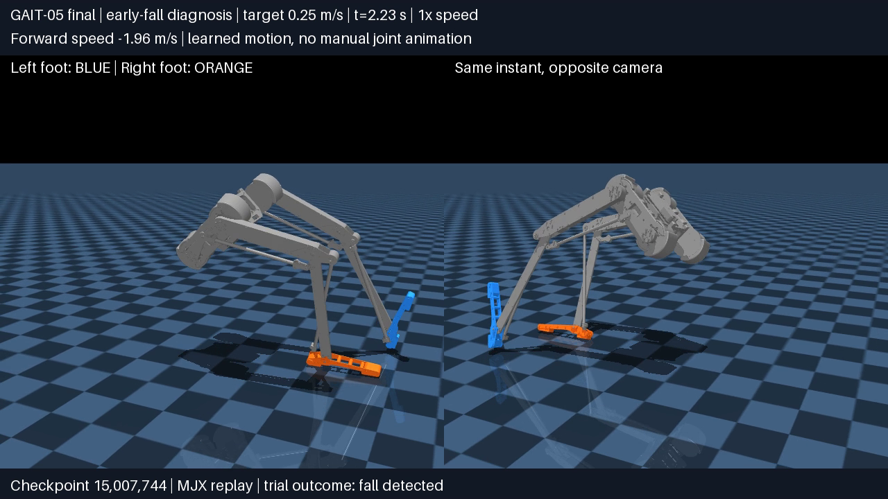
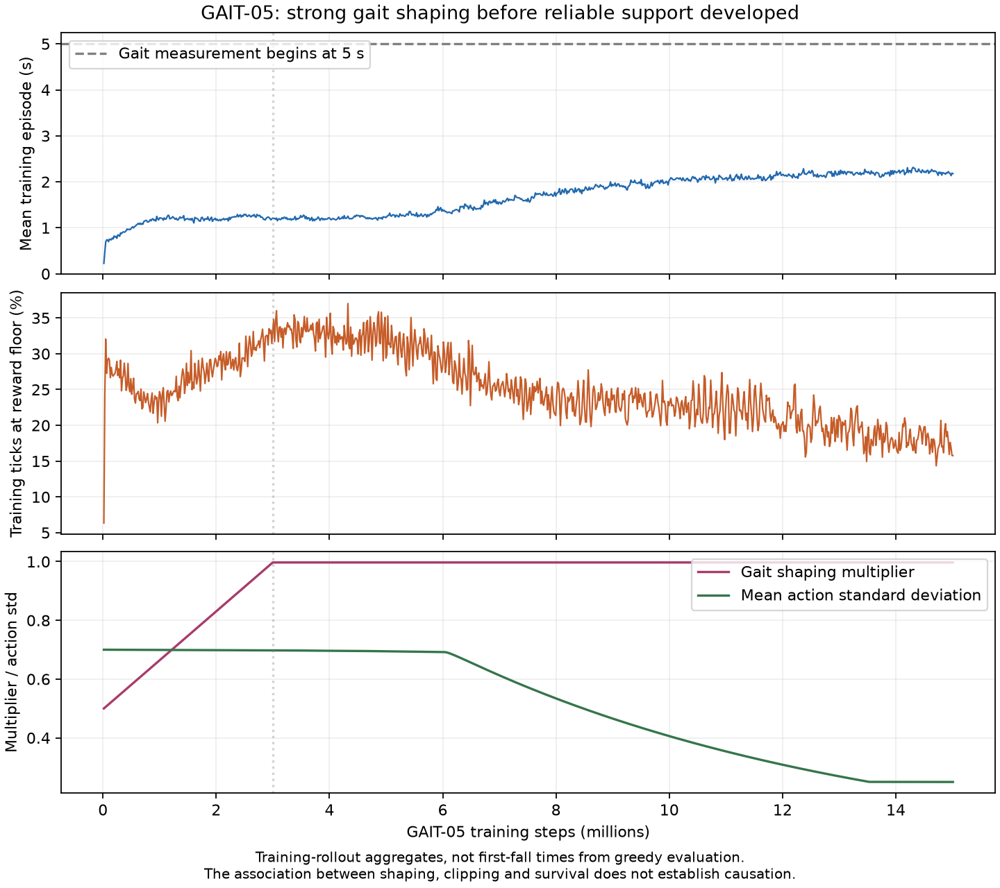

# GAIT-05 early-fall diagnosis

16 October 2026. Diagnostic job **3221291**, completed in **3m41s**, exit 0.
No training, reward or model changes were made.

**Finding:** the final policy attempts to step, but loses support and tips until
the torso crosses its height limit. Fresh training also inherited fine-tuning
settings and strong early gait shaping. These are plausible learning obstacles,
not individually proven causes.

## Paired replay evidence

The frozen GAIT-05 environment is shared by five policy/control cases, each with
12 nominal greedy trials at each of 0.20, 0.25 and 0.35 m/s (36 total), seed 3103,
six-second horizon. Only the first episode counts. Weights and observation
statistics change together; physics, reset and termination rules remain shared.
These nominal trials are often identical, not independent robustness tests.
Zero action means default gait/PD settings, **not zero torque**.

| Policy/control | At 0.20 m/s | At 0.25 m/s | At 0.35 m/s |
|---|---|---|---|
| Initial random policy | Falls at 1.58 s | Falls at 1.64 s | Falls at 1.80 s |
| GAIT-05 at 5.24M | Falls at 1.10 s | Falls at 1.25 s | Falls at 1.37 s |
| GAIT-05 final | Falls at 1.22 s | Falls at 2.10–2.45 s; mean 2.24 s | Falls at 1.51–1.52 s |
| GAIT-04 saved 14.22M | Falls at 3.10–4.04 s | **12/12 survive six seconds** | **12/12 survive six seconds** |
| Zero action | Falls at 4.84–5.38 s | Falls at 4.65–5.58 s | Falls at 4.89–5.06 s |

All **36 final GAIT-05 trials** terminate on `term_low`: torso height below
**0.60 m**, from a reset near 0.862 m. None trigger NaN, workspace, floor
penetration or 60-degree tilt termination. Height crosses its threshold before
tilt does; absence of `term_tip` does not mean the robot is upright. One GAIT-04
control trial at 0.20 m/s instead triggers the workspace limit.

At 0.25 m/s, final-policy trials collectively produce **12 valid right steps and
five valid left steps before falling**. Earlier evaluation counts were zero
because they only measured after five seconds, masking these early attempts.

Representative 0.25 m/s final-policy replay:

| Time | Torso height | Pitch | Body-forward speed | Contact pattern |
|---|---:|---:|---:|---|
| Reset | 0.862 m | ~0 degrees | 0 m/s | Both feet |
| 0.50 s | 0.868 m | −0.8 degrees | +0.23 m/s | Left support; right airborne, ~1.7 cm clearance |
| 1.00 s | 0.860 m | −1.4 degrees | +0.13 m/s | Both feet |
| Last pre-termination pose, 2.24 s | 0.605 m | −44.7 degrees | −2.08 m/s | Right support; left airborne |

It initially advances, then reverses and tips backward during a support
transition. At 0.20 m/s the representative fall pitches forward; at 0.35 m/s it
pitches backward sooner. Pose and transition metrics differ by up to one 10 ms
tick. Clips end at first termination, before auto-reset, rather than continuing
through ground impact.

Watch: [0.25 m/s fall](../report/videos/gait05_fall_0.25mps.mp4),
[0.20 m/s](../report/videos/gait05_fall_0.20mps.mp4),
[0.35 m/s](../report/videos/gait05_fall_0.35mps.mp4).

## Learning-setup findings

1. **Fine-tuning settings were reused for fresh training.** GAIT-05 inherited
   GAIT-04's 5e-5 to 1e-5 learning rate, 100-update warmup and 0.003 initial
   entropy coefficient. Original fresh GAIT-01 used 3e-4 to 1e-4, no warmup and
   0.01 initial entropy coefficient. GAIT-05's peak rate is six times smaller
   and its ending rate ten times smaller. This carryover was not validated for
   learning from scratch; its causal effect requires a controlled comparison.
2. **Strong shaping arrived before useful walking.** The multiplier starts at
   0.5 and reaches approximately 0.997 at 3M steps. Near 3M, episodes averaged
   1.21 s and 33.2% of ticks hit the reward floor (31.7% averaged over 2–4M).
   The final sample still had 15.8% floor hits. Original GAIT-01 started shaping
   at 0.15 over a 5M ramp, without the stronger bilateral costs. Clipping removes
   distinctions between some poor outcomes. This does **not** prove deliberate
   falling: the explicit fall penalty is 100, outside the per-tick floor.
3. **Exploration decayed before reliable survival.** The hard entropy deadline
   is 6M steps, when training episodes averaged 1.40 s. Action standard deviation
   later falls from ~0.69 to 0.25. Gait frequency converges to the 0.5 Hz floor,
   a two-second cycle, leaving little experience beyond one cycle before a fall.
   More exploration is not automatically beneficial; initial noise was already
   substantial. Its schedule deserves review alongside the optimizer.
4. **15M steps does not settle the fresh-policy question.** Original GAIT-01 also
   failed evaluation after 5M. GAIT-02 first recorded nonzero evaluation survival
   at 22,020,096 additional steps after the 5,013,504-step pilot: about **27M
   cumulative steps**. This does not guarantee success from extending GAIT-05;
   rewards, speed and optimizer differ as well as training age.
5. **The evaluation window hid early mechanics.** Post-5-second gait metrics and
   25-second acceptance remain useful, but need first-fall time/reason and
   stepping-from-reset diagnostics alongside them. Empty windows produce zero
   step counts and fallback speed errors, not measurements of early movement.

## Recommendation and limits

Keep the 0.25 m/s moving task and test a **cold-start walking curriculum**:
appropriate fresh-policy optimizer settings, mild bilateral incentives from
the start, and stronger gait shaping as walking survival improves. Preserve
strict final acceptance and all evaluated checkpoints; add early-fall logging.
This does not require a separate standing/startup training phase. Do not increase
dragging penalties again before resolving this earlier support-control problem.
A longer budget is more informative once early survival is improving.

GAIT-04's six-second survival at 0.25 m/s argues against the speed/reset being
inherently impossible in this simulator; it is not proof of a symmetric gait.
Zero-action falls confirm the reset is not a robust passively stable stance.
No final-policy NaNs or penetration terminations were observed, but model and
calibration errors are not exhaustively ruled out. Mean torque utilization alone
cannot exclude brief actuator saturation. The curriculum/optimizer explanations
remain hypotheses until training ablations. **No follow-up training submitted.**

## Evidence and reproduction

- [Paired summaries and checkpoint hashes](experiments/gait05_20261015_v1/diagnosis/summary.json).
- [Learning samples](experiments/gait05_20261015_v1/diagnosis/learning_summary.json).
- [Diagnostic provenance](experiments/gait05_20261015_v1/diagnosis/provenance.json).
- Script `RLframework/tools/diagnose_gait05.py`; launcher
  `RLframework/slurm/izar_cad_v2_gait05_diagnosis.sbatch`.
- Remote root `/home/rizkalla/running_robot/experiments/gait05_diagnosis_20261016_v1`;
  all raw traces remain in `output`. Final-policy trace also downloaded locally.
- Plot generator: `report/scripts/build_gait05_diagnosis.py`.
