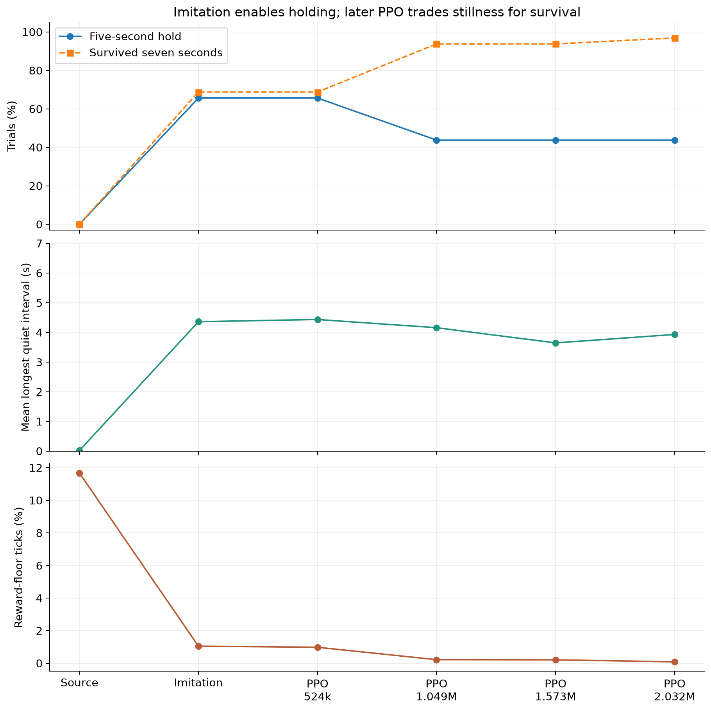

# DASH-01 report workspace

**Flat-feet symmetry v1 - completed 200M steps:** [videos and graphs](flatfeet-videos.html). Best checkpoint: 28/28 full-duration trials, 0.049 m/s tracking error.

**Experiment:** [reward changes and 200M run contract](../docs/flatfeet-symmetry-v1.md),
[submission record](../docs/experiments/dash01_flatfeet_symmetry_v1/STATUS.md).

**WALK-01:** [fresh 200M-step walking reproduction](../docs/walk01-experiment-report.md)
using Nathann's joystick reward/curricula, STOP disabled, and the newly supplied
CAD-v2 homing pose. [Status](../docs/experiments/walk01_20261019_v1/STATUS.md).
Completed in 13h29m, 200.01M steps. Best 169.57M checkpoint: 28/28 survival,
0.181 m/s tracking error. [Six best/final MJX replay videos](walk01-videos.html)
at 0.25/0.75/1.50 m/s; all six 25-second trials survive.

**Nathann policy transfer:** [paired original/CAD-v2 videos](policy-transfer01-videos.html)
and [experiment report](policy-transfer01.md). Original policy survives 20 seconds
at three commands; direct CAD-v2 swap and two simple mapping probes fall within
0.71–0.75 seconds. No new training launched.

**New direction — speed-first discovery:** branch `dash-01-v2-speed-discovery`.
[Nathann's reward and branch audit](nathann-speed-reward-audit.md) identifies the
existing `dash_sprint` objective and the limitations of the older 3.06 m/s result.
[Implementation plan](../docs/speed-discovery-plan.md). GAIT-01–11 remain archived
on `dash-01-v2` at `c035774`. [SPEED-01](../docs/speed01-experiment-report.md)
implements the first fresh five-hour experiment; see its
[status](../docs/experiments/speed01_20261019_v1/STATUS.md).

**GAIT-11:** [fresh continuous alternating walking](../docs/gait11-experiment-report.md)
at 0.15 m/s, eight-hour allocation without a step cap. Expected-foot commands
replace implicit sequencing; no mandatory pause between steps. Retains bilateral
quality rewards and gradually earned sliding penalties.
[Submission and validation status](../docs/experiments/gait11_20261019_v1/STATUS.md).
Completed: 65.65M steps in 7h52m. Final training-speed survival 12/12, but
24.44% incomplete attempts and low clearance remain; no checkpoint qualified.
[Watch six candidate/final replays](gait11-videos.html) with two camera angles
and slow motion; includes 0.10/0.15/0.20 m/s and the observed failures.

**GAIT-10, job 3223224:** [last 15M-step continuation](../docs/gait10-experiment-report.md)
from GAIT-09 final, with 10× repeated-step event cost and a continuous extra-lift
cost. Includes timing/progress corrections and an explicit decision to switch to
a fresh policy if sustained walking-quality progress fails.
[Status](../docs/experiments/gait10_20261018_v1/STATUS.md): completed in 1h43m23s,
15.01M steps. Final survival 12/12 at 0.25 m/s, but 50.41% incomplete attempts
and worse symmetry. Progress criterion failed; next branch is a fresh policy
with an explicit sequential stepping objective.

**GAIT-09, job 3222597:** [32M-step micro-step correction run](../docs/gait09-experiment-report.md)
submitted on 18 October 2026 from the GAIT-08 best candidate at 0.25 m/s.
Incomplete/repeated swing costs, bounded partial-progress credit and consistent
stance timing/history. [Current status](../docs/experiments/gait09_20261018_v1/STATUS.md):
completed in 3h26m45s, 32.01M steps. Final 0.25 m/s survival is 12/12 and
tracking/slip improved, but incomplete attempts remain 50% and repetitions persist.
No evaluated policy qualified as a clean gait.
Watch the [GAIT-09 candidate/final videos](gait09-videos.html), with two camera
angles, colored feet and slow-motion controls. Both fresh replays survive 25 s.

**18 October 2026:** [GAIT-08 micro-step reward audit](../docs/gait08-reward-audit.md)
identifies incomplete-step sequencing gaps, repeatable partial-progress rewards,
and cadence/stance timing conflicts. Includes reproducible reward-unit checks;
no training changes made.

**GAIT-08, job 3222272:** [30M-step continuation](../docs/gait08-experiment-report.md)
from GAIT-07 at 0.25 m/s, with the [next-foot rule](../docs/next-foot-reward.md)
enabled and full drag strength retained. Completed in 3h21m54s: at 0.25 m/s,
12/12 final trials survived, with approximately 10 valid steps per foot and much
less slip. No trial fully qualified: cycle timing/length symmetry and right-foot
clear-time fraction remain insufficient. Best diagnostic candidate: 25.17M steps.
Watch the [GAIT-08 candidate/final comparison](gait08-videos.html): both fresh
0.25 m/s replays survive 25 seconds and make 10 valid steps per foot after five seconds.

**17 October 2026:** [GAIT-07](../docs/gait07-experiment-report.md), job **3222141**,
continues GAIT-06 at 0.25 m/s with a separate gradual penalty for actual foot-floor
sliding in every horizontal direction. Its movement gate does not require valid
steps. Existing bilateral rewards remain. Cleaner stepping comes first; varying
commands and small pushes are later stages. Completed 15M additional steps in
1h47m16s: final 0.25 m/s survival 12/12, but no qualified gait and mean valid steps
0.25 left / 8.5 right. Right-foot slip decreased; left-foot slip increased slightly.
Open the [GAIT-07 video comparison](gait07-videos.html), including all three speeds
and the preceding GAIT-06 video. The 0.25 m/s replay records 0 left / 11 right steps.

**16 October 2026:** [GAIT-06](../docs/gait06-experiment-report.md), job **3221307**,
trained a fresh 0.25 m/s policy with cold-start PPO settings and bilateral/drag
shaping gated by sustained forward movement. Completed 15M steps in 1h28m23s:
8/12 final trials survived at 0.25 m/s, but 0/12 qualified and only one valid step
per foot was recorded across those trials. The shaping gate never opened.
Watch the [current policy video](gait06-videos.html), with two camera angles and
colored feet. The 0.25 m/s replay survives 25 seconds but records no valid steps.

**New model, 14 October 2026:** [DASH-01 v2 CAD and mass-property audit](cad-v2-import.md)
documents the supplied CAD, corrected inertials, 1 kg torso allowance, mass
comparison figures and integration assumptions. The
[GAIT-01 experiment report](../docs/gait01-experiment-report.md) records the new
walking pilot, the failed fixed-target standing check and its diagnosis.
The [GAIT-02 report](../docs/gait02-experiment-report.md) records the longer
30M-step continuation, checkpoint selection and schedule changes.
Watch the [best policy at a 0.35 m/s target](videos/gait02_best_0.35mps.mp4),
or see [all three gait replay clips](../docs/gait02-experiment-report.md#video-replay--15-october-2026).
These show learned locomotion, but right-foot dragging means the gait is not accepted.
The [GAIT-03 report](../docs/gait03-experiment-report.md) records the approved
bilateral stepping rewards and gait-quality checks, submitted as job **3219917**.
It completed 5M steps: all 12 final trials survived, but none passed gait criteria;
the right foot still made no valid steps. The bilateral walking problem remains open.
The [GAIT-04 report](../docs/gait04-experiment-report.md) documents stronger
swing-contact penalties and incremental bilateral progress rewards. Job **3220118**
completed 15M additional steps. At 14.68M, all 12 trials survived and made 5-8
right steps each; final survival regressed to 8/12. No evaluation passed all gait criteria.
Watch the [GAIT-04 video comparison](gait04-videos.html): the saved 14.22M policy
and final policy, with two camera angles and colored feet.
The [GAIT-05 report](../docs/gait05-experiment-report.md) documents fresh training
at 0.25 m/s with unchanged GAIT-04 rewards, three-speed evaluation and complete
evaluated-checkpoint retention. Job **3220364** completed 15M steps in 1h24m56s;
no trial survived at any evaluated speed throughout training. Fresh training did
not establish stable walking.
The [early-fall diagnosis](../docs/gait05-early-fall-diagnosis.md) shows loss of
support after an initial step and identifies concerns with the fresh-training
setup. It includes a [0.25 m/s fall replay](videos/gait05_fall_0.25mps.mp4).
The current scope is walking; a known homing pose and separate standing work
will follow later. The STOP results
below concern the previous robot models.

Updated **12 October 2026**. This folder gathers the evidence needed for the final
report and presentations. It describes the recorded STOP-01 to STOP-03 work; no
new training was launched to build it.

**Current result:** imitation enabled a five-second quiet hold in **21/32**
near-standing trials. The best recorded STOP-03 hold checkpoint is PPO step
**524,288**. The final checkpoint survived more often but held still successfully
in only **14/32** trials. Reliable stopping from motion remains unvalidated.

Approved next experiment: [STOP-04 diagnostic and preservation pilot](data/notes/stop04-experiment-report.md),
submitted as job **3215784**. Its results are pending; the figures below remain
the recorded STOP-03 evidence.

Start with [the visual gallery](index.html) for figures and playable videos, or
use these documents:

| Document | Purpose |
|---|---|
| [Experiment story](experiments.md) | What changed, why, and what happened |
| [Current control architecture](architecture.md) | Sensors, networks, gait, motors, STOP handling |
| [Measurement and interpretation](evaluation.md) | Exact success criteria and limits of the evidence |
| [Figure and video guide](assets.md) | Captions, selection rationale, provenance and missing assets |
| [Presentation outline](presentation.md) | Eight-slide narrative and speaker notes |
| [Work log and next questions](work-log.md) | Decisions, unresolved questions and update procedure |



## Folder conventions

- `figures/`: plots and architecture diagram, each as PNG, SVG and PDF. Use PDF/SVG
  in the final report, PNG in slides.
- `videos/`: copies of existing simulation clips, with explicit labels in the guide.
- `data/`: copied metrics, configuration, selected code and historical notes.
  Original experiment folders remain authoritative; copies make this collection portable.
- `tables/`: generated CSV summaries for report tables.
- `scripts/build_report.py`: copies inputs, rebuilds plots/gallery/tables and records hashes.
- `manifest.json`: source paths, SHA-256 hashes, video metadata and generated outputs.

From the repository root, regenerate the collection without connecting to SCITAS:

```powershell
.\.venv\Scripts\python.exe report/scripts/build_report.py
```

The builder uses the currently downloaded metrics. Updating remote results is a
separate, deliberate step. It does not change policy weights, rewards or training
code. Authored explanations and decisions should be updated when new evidence arrives.

After a fresh Git clone, use `--frozen` to rebuild from the committed report inputs.
Raw pose traces and transfer archives are kept locally/on SCITAS; see the
[artifact policy](../docs/experiments/README.md). Curated figures and videos remain
versioned so this gallery can be opened immediately.

After editing report notes only, refresh checksums without rebuilding plots:

```powershell
.\.venv\Scripts\python.exe report/scripts/build_report.py --manifest-only
```

Latest completed results: [STOP-06 comparison](data/stop06_20261012_v1/STATUS.md).
The gallery figures cover the earlier experiments; STOP-06 plots accompany its
downloaded run records.

Raw source records: [STOP-01 log](../docs/stop-training-report.md),
[STOP-02 log](../docs/stop02-experiment-report.md),
[STOP-03 log](../docs/stop03-experiment-report.md).

## Report video storage

New WALK-01, transfer and flat-feet clips use compact H.264 encodings at their
existing gallery paths. Simulation frames, playback speed and durations are
preserved. [Encoding records](video-encoding.json) connect the compact file hashes
to the original video hashes in historical provenance records. Full-quality
originals remain local in ignored `videos/.originals/`. Re-run
`python report/scripts/compact_report_videos.py` to encode newly rendered clips.
