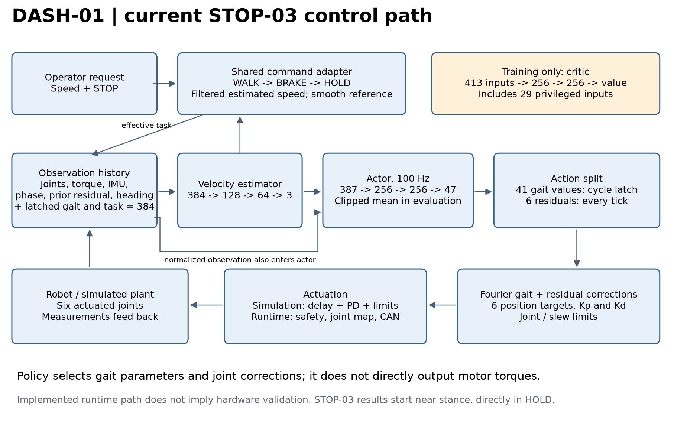

# Current control architecture

## WALK-01 update

The current submitted experiment restores Nathann's speed-command tracking
recipe on CAD-v2 with the supplied homing pose as the nominal reset. It starts
fresh, retains the 384-input/47-action policy interface and six-motor PD control,
and disables STOP/standing tasks. The same 41 gait parameters plus six residuals
control locomotion; no step-order supervisor is present. Homing is the starting
configuration, not a separately trained startup controller. See the
[WALK-01 contract](../docs/walk01-experiment-report.md).

## SPEED-01 update (19 October 2026)

The active speed-discovery experiment starts a fresh policy on the corrected,
fully free CAD-v2 model. At 100 Hz it controls 41 gait-generator parameters and
six residual joint corrections; the calibrated six-motor PD/torque-speed model
and 1 kHz physics remain. Its ordinary observations omit GAIT-11's contact-derived
step supervisor. There is no imposed foot order, target-speed tracking, standing
phase or STOP command. Signed world-X speed is the objective, with posture,
control, energy, thermal and actual-contact sliding costs. Running or hopping
can be successful under this objective; clean alternating walking is not assured.
This remains simulation work, without physical-robot validation. See the
[reward and evaluation contract](../docs/speed01-experiment-report.md).

## GAIT-11 update (19 October 2026)

The fresh CAD-v2 walking experiment adds a contact-derived step supervisor to the
100 Hz gait-generator policy. It commands alternating supported swings, switches
the expected foot after valid touchdown, and requires no intervening stop or
settling dwell. Four new actor features encode expected foot, active swing and
support presence; the 47-action motor-control interface is unchanged.

These commands use simulation contact information. Hardware requires a validated
contact/step estimator and matching supervisor; the existing deployment runtime
does not yet support this observation layout. See the
[GAIT-11 design and retained reward lessons](../docs/gait11-experiment-report.md).

The following sections document the earlier STOP-03 architecture and deployment
path, rather than claiming GAIT-11 has already been deployed.

Scope: the **STOP-03 simulation policy and its v2 deployment path**, inspected on
12 October 2026. A compatible runtime exists; these results do not establish that
this checkpoint has been exported, installed or validated on the physical robot.
Older v1, library-gait and fitted-brake descriptions elsewhere in the repository
describe other configurations. The saved STOP-03 configuration and executable code
are the references for this document.



## What the policy actually controls

The policy is a neural network that maps recent measurements and the task command
to an action. It does not directly output six motor torques. At **100 Hz**, it
outputs **47 values** controlling a gait generator and corrective joint offsets.
That generator produces six joint-position targets and proportional/derivative
gains. The motor model then turns tracking errors into torque.

This combines a structured periodic gait with learned feedback. The periodic
generator supplies coordinated movement; the policy can correct it from current
measurements. No separate hand-written IMU reflex is active in this policy variant.

## Inputs and networks

The actor has **384 observation values**:

| Input | Width | Meaning |
|---|---:|---|
| Ten sensor/history frames | 340 | 34 values per frame, sampled every two control ticks |
| Current latched gait specification | 41 | What gait is currently being executed |
| Effective task | 2 | Reference speed divided by 2.5 m/s, and RUN/HOLD bit |
| Commit flag | 1 | Whether this action can update the gait specification |

Each 34-value frame contains six joint positions, six joint velocities, six torque
measurements, gravity direction (3), angular velocity (3), filtered yaw rate (1),
gait phase cosine/sine (2), previous residuals (6), and integrated heading error (1).
Ten frames at a 20 ms stride span **180 ms** from oldest to newest. Observation
normalization uses saved statistics, frozen during this pilot.

| Network | Layers | Role |
|---|---|---|
| Velocity estimator | 384 -> 128 -> 64 -> 3 | Estimates body velocity from actor observations |
| Actor | (384 + 3) -> 256 -> 256 -> 47 | Produces the action mean |
| Critic, training only | 413 -> 256 -> 256 -> 1 | Predicts return for PPO |

Hidden activations are tanh; output heads are linear. The actor receives an estimate
of velocity, not simulator ground truth. The extra **29 privileged critic inputs**
include true velocity, contact/support information, body/plant properties and thermal
state. They are used in training; they are not deployment sensors. PPO also trains
the estimator against privileged velocity, with its output detached from actor
gradients. Evaluation/deployment use the clipped mean action; PPO samples a Gaussian.

## Two action timescales and actuation

| Action block | Width | Update |
|---|---:|---|
| Fourier trajectories: cam, thigh and hip | 21 | Latched when the gait clock wraps |
| Fourier proportional and derivative gain profiles | 14 | Same latch |
| Frequency, left/right phase offset, asymmetry, three offsets | 6 | Same latch |
| Joint residual corrections | 6 | Every 10 ms |

The first 41 values are only committed on the flagged tick; between commits, the
previous gait specification continues. The six residuals remain active each tick.
Joint order is left hip-roll/cam/thigh, then right hip-roll/cam/thigh. Residual
scales are `[0.2, 0.1, 0.2, 0.2, 0.1, 0.2]` radians per action unit.

The control law is, schematically:

```text
q_target = Fourier_gait(specification, phase, nominal_pose) + scale * residual
torque   = clip(Kp(phase) * (q_target - q) - Kd(phase) * q_dot, motor_limits)
```

Joint-range and velocity/acceleration limits act on targets. Simulation models
command transport delay (nominal 12 ms), motor torque/speed limits and thermal state;
MuJoCo/MJX advances physics in 1 ms substeps. The deployment controller returns
targets and gains to the downstream safety, joint-mapping and CAN/motor path. It
does not add another simulated transport delay on top of real transport.

**Zero action is not motors off.** It selects nominal stance and default gains,
still producing corrective PD torques. This made it a useful stance demonstration
teacher. The learned student is evaluated through its own actions; there is no
zero-action HOLD override in the STOP-03 learned policy.

## How a STOP request enters the loop

The shared command adapter has three phases:

1. **WALK:** send the requested reference speed; task RUN bit is 1.
2. **BRAKE:** on the STOP edge, capture the low-pass-filtered estimated forward
   speed, then lower the reference smoothly. Keep RUN=1 so stepping can continue.
3. **HOLD:** when the ramp duration expires, reference speed is 0 and RUN=0.
   The policy must balance and become still. Repeated STOP requests do not restart
   the ramp. A run initialized in HOLD bypasses braking.

The filter time constant is 0.1 s. With initial estimated speed `v0` clipped to
`[0, 2.5]`, ramp duration and reference are:

```text
T = max(2 seconds, 1.5 * v0 / 0.5 m/s²)
u = clip(time_since_STOP / T, 0, 1)
v_reference = v0 * (1 - 3*u² + 2*u³)
```

The maximum reference deceleration is 0.5 m/s². This limits the **command**, not
the robot's actual acceleration. Example durations are 3 s from 1 m/s and 6 s
from 2 m/s. The current BRAKE-to-HOLD handoff is **time-based**; actual low speed
and stable posture are not yet conditions for switching. The adapter uses estimated
velocity and is shared between JAX training and NumPy deployment.

STOP-03's standing benchmark starts directly in HOLD. It therefore demonstrates
part of this chain, not the complete WALK -> BRAKE -> HOLD transition. Policy STOP
also differs from the deployment safety kill, which takes control away from the policy.

## Learning architecture

The warm start is STOP-01B's final actor and calibrated estimator, descended from
the original 180M-step walking policy. The exported bundle does not contain a
critic, so a fresh critic is fitted before PPO.

STOP-03 first fits the actor to two datasets: nominal stance actions for HOLD and
the frozen source actor's actions for RUN. Only actor mean weights change during
this stage. Then, if physical holding improves and walking is retained, PPO trains
in 1,024 parallel MJX environments, collecting 64 ticks per rollout. It trains
standing with 75% initial HOLD resets and retains RUN examples. Evaluation is
deterministic and separate from the training reward.

The physical robot lacks the simulation's foot-contact signal. Gait clock contact
resynchronization available in simulation does not automatically exist on hardware;
the deployment path can free-run its phase. This remains a relevant sim-to-real
distinction, along with sensing, delay and plant variation.

## Code references

- [Networks](data/code/RLframework/networks.py), [observations and simulation](data/code/RLframework/env.py).
- [Gait decoding](data/code/RLframework/gait.py), [motor model](data/code/RLframework/drive.py).
- [Command adapter](data/code/RLframework/stop_adapter.py), [shared schedule](data/code/controller/deploy/stop_schedule.py).
- [Deployment controller](data/code/controller/deploy/controller_v2.py).
- [Imitation](data/code/RLframework/standing_imitation.py), [PPO](data/code/RLframework/ppo.py).
- [Exact run configuration](data/stop03_20261007_v1/resolved_config.json).

Copies of these sources are preserved under `data/code/` with hashes in the manifest.
