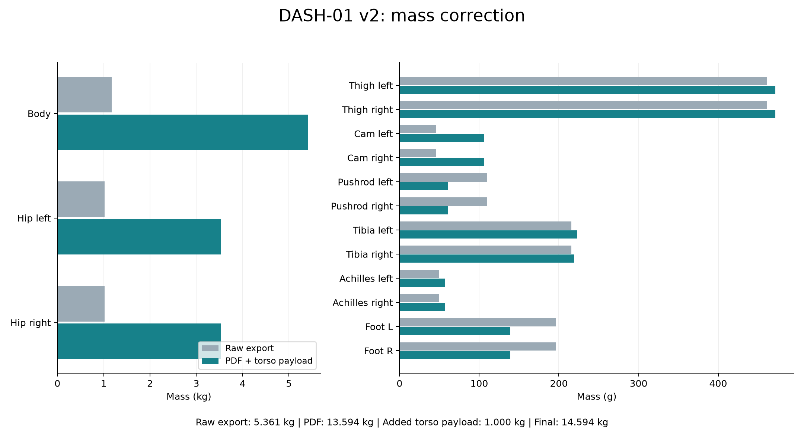
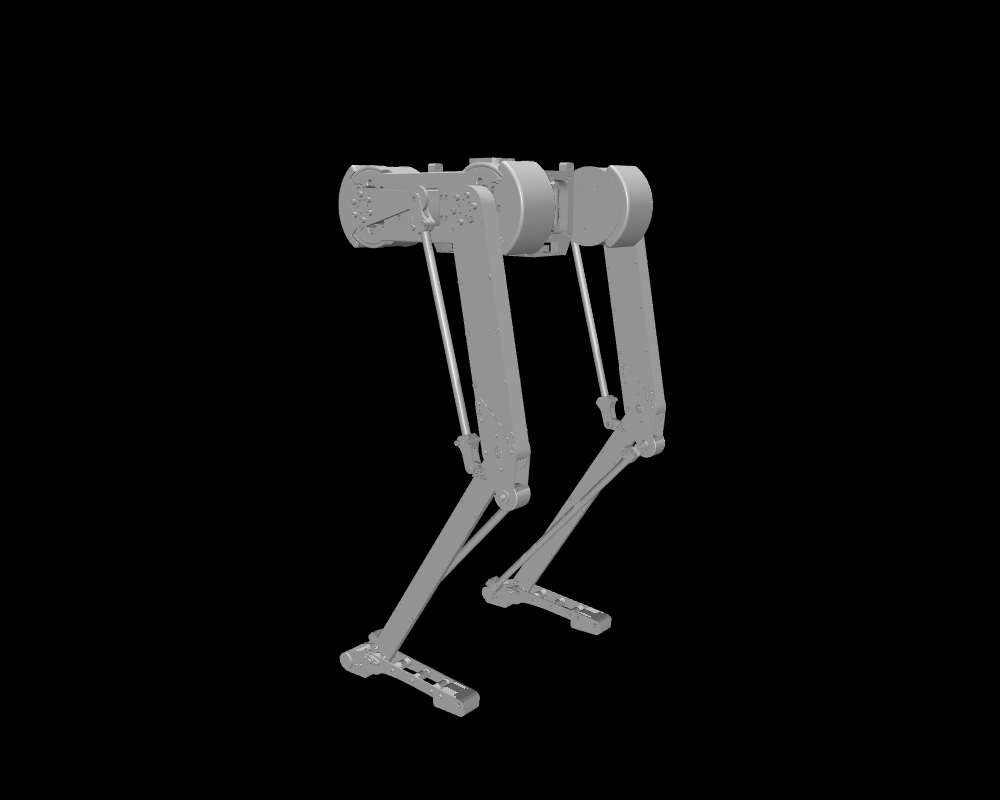

# DASH-01 v2: CAD and mass-property audit

**14 October 2026 — model preparation, no training run.**

The supplied CAD export has been preserved and a separate corrected MuJoCo XML
generated. Its total mass is **14.594154 kg**, comprising **13.594154 kg** from the
PDF and **1 kg** of additional torso mass for cables/accessories. All 15 links
pass the implemented inertial checks. The model is an inspection model; the
floating base, contacts, actuator/controller integration and standing reset
remain to be prepared before training.

## Inputs and user confirmations

- Original: [`EXPORT_assembly-v34_closed.xml`](../dash-01CAD-v2/EXPORT_assembly_closed/EXPORT_assembly-v34_closed.xml)
  and its 15 STL meshes. No source geometry, joint transforms or limits changed.
- Authoritative physical properties: [`inerties_masses.pdf`](../dash-01CAD-v2/properties/inerties_masses.pdf),
  17 pages, covering 14 named part types. The single Foot entry is applied to
  both feet; their exported meshes have identical hashes.
- The user confirmed that the torso/hip masses **include motors and battery**.
  Historical motor point masses must not be added again.
- The user confirmed that the PDF **already uses the exported body frames**.
  All COMs and tensors are therefore applied directly. No inferred frame
  rotation or translation is applied.

The reviewed [property table](../dash-01CAD-v2/properties/mass_properties.json)
retains the original units, both sets of inertia tensors, page references and
PDF hash. The [mapping](../dash-01CAD-v2/properties/body_mapping.json) records
each XML body and the payload assumption. The
[machine-readable audit](../dash-01CAD-v2/generated/audit.json) records input
hashes, per-body results, loop gaps and validation details.

## Corrections

The raw CAD totals only **5.360707 kg**. Its inertials are replaced with the PDF
values rather than scaled by mass alone. This matters because the COM and
distribution of mass also change.

| Link | Raw export, kg per link | Corrected, kg per link |
|---|---:|---:|
| Torso | 1.167850 | 5.409075, including allowance |
| Hip, each | 1.017856 | 3.537567 |
| Thigh, each | 0.461614 | 0.471484 |
| Cam, each | 0.045926 | 0.106052 |
| Pushrod, each | 0.109552 | 0.060723 |
| Tibia, left | 0.215770 | 0.222524 |
| Tibia, right | 0.215770 | 0.218767 |
| Achilles, each | 0.049756 | 0.057130 |
| Foot, each | 0.195953 | 0.138938 |



[PDF figure](figures/cad_v2_mass_audit.pdf) ·
[SVG figure](figures/cad_v2_mass_audit.svg) ·
[CSV table](tables/cad_v2_mass_audit.csv)

### Units and tensor convention

Mass is converted from grams to kilograms (`× 1e-3`); COM from millimetres to
metres (`× 1e-3`); inertia from g mm² to kg m² (`× 1e-9`). The **COM tensor** is
used, not the origin tensor. Off-diagonal entries retain their signs. MuJoCo's
`fullinertia` order is `Ixx Iyy Izz Ixy Ixz Iyz`, and explicit inertials remain
authoritative with `inertiafromgeom="false"`.
See the [MuJoCo XML reference](https://mujoco.readthedocs.io/en/latest/XMLreference.html#body-inertial).

The PDF's origin tensors provide an independent consistency check via
`I_origin = I_COM + m * ((c·c) Identity - c cᵀ)`. The largest relative residual
is **0.0308%**, consistent with the source's rounded COM/tensor values. This
also supports using the supplied signs without reversing products of inertia.

### Extra kilogram

The PDF torso mass is 4.409075 kg; the corrected torso is **5.409075 kg**.
Without a measured location/shape for the accessories, the added kilogram is
assumed to share the torso's COM and normalized mass distribution. Thus:

`I_torso_corrected = I_torso_PDF × (5.409075 / 4.409075)`

The COM is unchanged by this allowance. This is an approximation, not a new
CAD measurement. If a concentrated accessory location becomes known, replace
the assumption with the component's mass/COM/inertia and the parallel-axis
combination. The parameter is explicit and rebuilds do not accumulate it.

## Aberrations and discrepancies

| Finding | Action / interpretation |
|---|---|
| Large torso/hip mass deficits in the export | Replaced with inclusive PDF assembly properties; no double counting of motors/battery. |
| Cam, pushrod and foot masses also differ substantially | Applied each supplied tensor and COM, not a blanket density change. |
| PDF thigh bounding-box width is **264.9 mm**, mesh width is **61.5 mm** | Recorded for CAD review. Could reflect different assembly contents or an export/report issue; no mesh rescaling inferred from it. |
| PDF and export have different revision labels | Preserved both sources and hashes. Labels alone do not prove geometry equivalence; user confirms physical-property frames. |
| Right cam properties resemble a ~5° rotation of mirrored left properties; right tibia mesh coordinates have offsets | Investigated, then applied PDF values directly following the user's explicit frame confirmation. These are observations, not established frame errors. |
| Right thigh limits differ from sign-reversed left limits by about **4.53°** | Retained CAD limits. Verify hardware travel and joint-zero conventions before actuation; do not force symmetry. |
| Tibia masses differ by **3.757 g** | Retained the supplied asymmetry. |
| All four loop endpoints coincide within **0.000474 mm** | No loop-anchor correction needed at the exported pose. |
| Root is fixed; all collision masks are zero; no floor or actuators | These are incomplete simulation settings, not corrected physical properties. Training needs a dedicated plant configuration. |
| Achilles bodies are rigid and have no spring parameters | Mechanical compliance, if present in hardware, still needs specification. |

The COM-in-bounding-box check passes for every link, but it does not prove the
mesh contains all physical components or that its surface is an accurate
collision model. The width discrepancy above is still worth checking in CAD.

## Validation and its limits

Using local MuJoCo **3.13.0**:

- 15 mapped link inertials; finite positive masses, finite COMs, symmetric
  positive-definite tensors and valid principal-inertia triangle inequalities.
- Compiled masses, COMs and reconstructed tensors agree with requested values
  within numerical tolerances; no automatic inertia balancing enabled.
- All four loops close within 0.001 mm initially and remain below 0.01 mm in a
  **0.2-second, zero-gravity, fixed-base** numerical smoke test; no MuJoCo warnings.
- Seven regression tests pass: units, payload distribution, coordinate transforms,
  invalid-input rejection, PDF origin/COM consistency, strict body lookup,
  source preservation, unchanged kinematics and repeatable builds are covered.

This does **not** validate standing, foot contacts, fall behavior, joint travel
under load or policy performance. The exported tree has 14 hinge coordinates
and four connect equalities; it is not the old flat-foot plant.



Static MuJoCo rendering of the exported pose, with display lighting adjusted
for visibility. This is not a trained posture or evidence of balance.

## Code and reproducibility

[`prepare_cad_v2.py`](../RLframework/model/prepare_cad_v2.py) implements the v2
import and audit, exposed through the existing `make_plant.py --cad-v2` entry.
It reuses the body-inertial patching helper extracted from
[`apply_identified.py`](../controller/identification/apply_identified.py).
The old identification CLI retains its permissive handling of missing names;
the v2 path requires an exact body mapping. Historical flat-foot model outputs
and policies are unchanged.

```powershell
.\.venv\Scripts\python.exe RLframework/model/make_plant.py --cad-v2
.\.venv\Scripts\python.exe RLframework/model/make_plant.py --cad-v2 --report
.\.venv\Scripts\python.exe -m unittest RLframework.tests.test_cad_v2 -v
.\.venv\Scripts\python.exe report/scripts/build_cad_v2_assets.py --render
.\.venv\Scripts\python.exe report/scripts/build_report.py --manifest-only
```

The original PDF was extracted locally with PyMuPDF. Rebuilding the model uses
the reviewed JSON and needs only the existing NumPy/MuJoCo dependencies.

## Next integration steps

Update, 14 October: the floating base, six motors, four rigid linkage loops,
sole contacts and simulation reset are now implemented. The user confirmed
unchanged motors and no Achilles springs. See [GAIT-01](../docs/gait01-experiment-report.md)
for validation and walking training. Its exact nominal pose is not a robust
standing or hardware homing solution; the user will provide homing later.
The checklist below records the integration work identified at import time.

1. Check the thigh-width discrepancy and actual joint limits in CAD/hardware.
2. Define the v2 motor signs/zero angles and actuator dynamics, retaining all four
   linkage constraints and specifying any real spring compliance.
3. Add floating-base motion, foot/ground collision geometry and a validated
   upright reset pose. Test gravity, contacts and passive/controlled dynamics.
4. Adapt the training observation/action and gait code to the articulated feet,
   then start the planned gait and speed-control campaign.

No previous policy is claimed to work on this new model, and no SCITAS training
was launched during this import.
