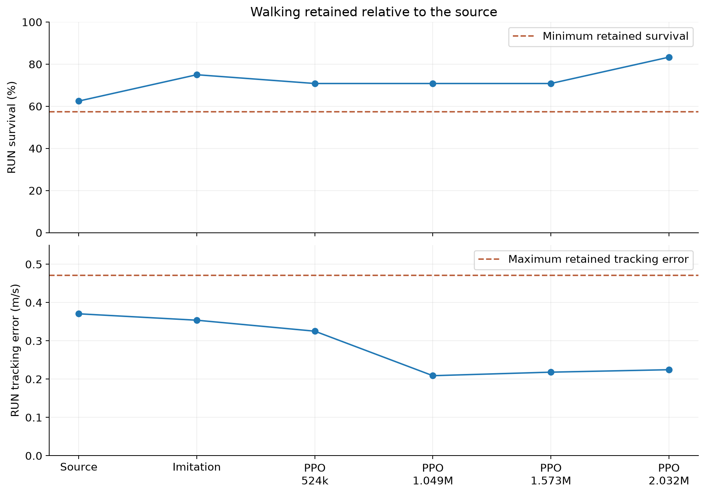
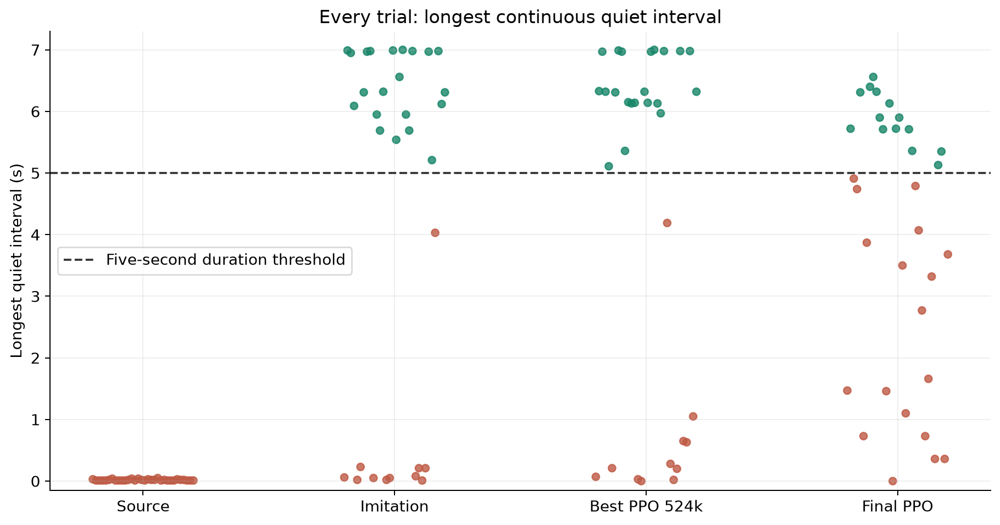

# What counts as success

The current physical benchmark is implemented in `RLframework/stop02_metrics.py`,
independently of reward. A five-second interval must meet all instantaneous quiet
conditions continuously:

| Quantity | Requirement |
|---|---|
| Horizontal body speed | < 0.10 m/s |
| Angular-speed norm | < 0.30 rad/s |
| Joint-velocity RMS | < 0.50 rad/s |
| Body tilt | < 10 degrees |
| Support within the interval | Both-feet support on at least 90% of ticks |
| Drift | Maximum distance from interval-start position <= 0.10 m |
| Episode validity | No fall/reset; survive the full prescribed STOP interval |

The standing test allows seven seconds from near-stance: two seconds of settling
allowance plus a five-second window. It has 32 trials, seed 4102, nominal plant,
0.03 rad joint reset noise and no observation noise. STOP-03 uses this test.
Moving-transition tests allow braking plus the settling/holding window and also
require a qualifying moving approach. A successful reset after a fall cannot rescue
the original episode. Restart is not evaluated by the standing benchmark; its
stored zero restart fraction must not be interpreted as 32 failed restart tests.

STOP-01 used an earlier transition protocol. Do not directly rank its percentages
against the later five-second standing benchmark as though all tests were identical.

## Walking retention

The same run's **pre-imitation source** is the reference, using nonzero commands
in the evaluation ladder. Mean survival may decrease by at most 0.05, and mean
tracking error may increase by at most 0.10 m/s. Passing this gate is a relative
retention result; it does not establish robust walking at every speed.

## Reward versus measurement

HOLD reward includes a multiplicative quiet-stance income (maximum 3) plus separate
bounded speed (maximum 2), angular quietness (1), joint quietness (1), and support
(0.5) terms. Posture/height gating limits credit while fallen. A duration bonus
encourages sustained quietness. Pose and oscillation penalties remain, with weights
0.5 and 1 in the standing pilots. Other inherited costs and scaling also apply;
these maxima are not the complete scalar reward budget.

Positive reward, low average speed and long survival are informative but cannot
replace the physical five-second test. Final STOP-03 had about 0.0133 m/s mean
residual speed among STOP survivors, yet only 14/32 successful holds. Small speed
alone says nothing conclusive about angular motion, joint motion or continuous
quiet duration.

All 32 trials are shown by the distribution figure; failed episodes are not removed.
The dashed five-second line indicates duration only. Drift, support and survival
requirements still apply to a trial above that line.

## Limits and unresolved questions

- One training seed and a fixed evaluation seed; no multi-seed uncertainty estimate.
- Nominal simulation results; no validated hardware STOP behavior.
- No STOP-03 moving-approach or restart evaluation in the downloaded evidence.
- Available videos mainly illustrate earlier diagnostics, not STOP-03 successes.
- Different JAX graphs can change trajectories; source-baseline differences between
  runs should not be mistaken for controlled policy improvements.
- Per-tick final-policy diagnostics are needed to identify the failing quietness
  condition. Drift or joint motion are possibilities, not established explanations.
