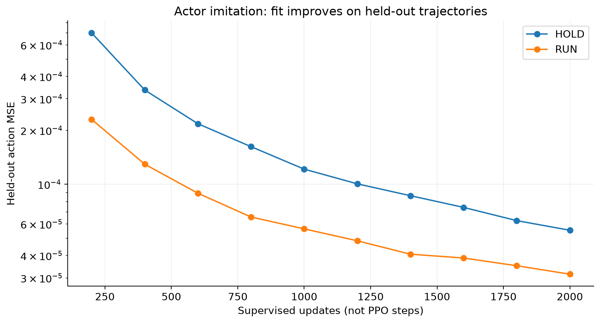
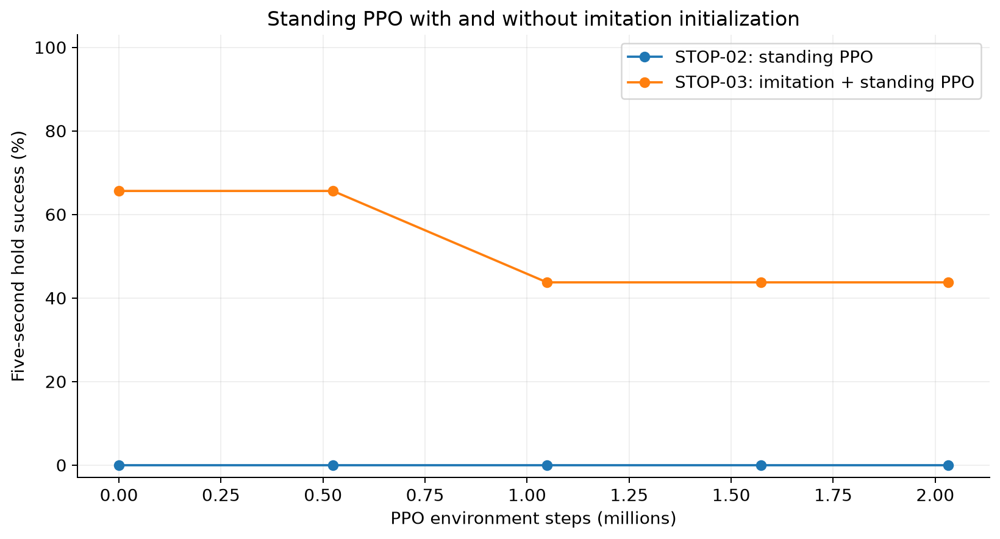

# Experiment story: learning to stop

## Problem and starting point

We inherited a trained walking policy. Changing the operator command to STOP did
not reliably produce a balanced, stationary robot. The task is more demanding than
making forward speed small: the robot must remain upright, settle its joints and
body, and maintain support for a measurable period.

## Recorded sequence

| Stage | Main change or question | Recorded finding |
|---|---|---|
| Original 180M walker | Starting locomotion capability | Walking source; not evidence of stopping |
| STOP-01B, job 3200768 | Fine-tune walking policy with STOP rewards | 20,054,016 PPO steps; stopping benchmark still failed |
| STOP-02 diagnostics | Smooth ramp, longer observation window, fixed-stance probe | Ramp delayed falling; did not produce holds. Fixed stance was feasible nominally |
| STOP-02 standing, job 3204982 | Dense holding rewards; 75% initial HOLD resets | 2,031,616 steps; 0/32 holds; final walking retention failed |
| STOP-03, job 3205920 | Imitate feasible stance while retaining source walking actions | 21/32 holds after imitation; later PPO increased survival but reduced holds |

Submission dates and complete settings remain in the historical records copied to
`data/notes/`. STOP-03 was submitted 7 October; Slurm records its execution as
8 October, 00:30:14-00:56:42. Earlier status checks recorded a client/server date
discrepancy; do not silently rewrite those original timestamps.

## Why the ramp was insufficient

The smooth ramp changed the desired speed, giving the robot more time to brake.
Using the calibrated STOP-01B estimator, median time from STOP to termination among
qualifying approaches increased from about 0.98 s for the abrupt command to 3.83 s
with the ramp. Both diagnostics still had zero successful holds. A longer ramp also
creates a longer braking phase, so survival time alone is not a measure of stopping.

The decisive observation was failure from an already near-standing reset. In
STOP-02's final evaluation, every trial tipped, at a mean of roughly 2.05 s. Initial
walking momentum cannot explain those failures. We needed a policy that could
stand, not just a slower reference.

The fixed-zero-action probe demonstrated a feasible nominal PD stance: 31/32 holds
in the corrected diagnostic, with joint reset noise disabled. This is a feasibility
probe, not learned stopping. The original source bundle also lacked the privileged
velocity normalization needed by the speed adapter; comparisons using its poorly
calibrated estimate were excluded from the main ramp conclusion.

## STOP-03: what changed

Rewards, command ramp and PPO settings were kept as in the standing pilot. The main
intervention was supervised actor initialization. The source actor generated RUN
examples, while zero actions generated HOLD examples. A 32-environment, 8-second
collection used 0.03 rad reset joint noise. All 16 HOLD demonstration environments
survived; this is a different test from the earlier noise-free 32-trial probe.

Training used 2,000 Adam updates with equal numbers of HOLD/RUN examples and loss
`HOLD MSE + 2 * RUN MSE`. Whole trajectories were held out. The estimator, critic,
observation statistics and exploration standard deviation stayed fixed during
imitation. The student then had to improve physical holding and retain walking
before starting the 2M-step PPO stage.

## What the results support

The source had 0/32 holds; imitation produced 21/32. The early PPO keeper at 524,288
steps retained 21/32, with slightly lower residual speed. Final PPO had 14/32 holds
but 31/32 seven-second survivors. Walking retention passed at every STOP-03 check.

This supports imitation as a useful initialization for this pilot. It does not show
that additional PPO automatically improves stillness. The training objective can
improve balance/survival without satisfying every strict quietness condition.
The precise cause of each surviving failure remains to be established from traces.

The checkpoints are repeated evaluations of one training seed, not independent
replications. STOP-02 and STOP-03 share the standing protocol, but their baseline
measurements differ slightly; this is not a controlled multi-seed causal estimate.

## Current selection

Preserve both `imitation_candidate.msgpack` and `best_stop.msgpack` (524,288 PPO
steps) from `dash_stop03_imitation_s0`. The best hold keeper is preferable to the
final checkpoint for showcasing the measured holding objective. These checkpoints
remain on SCITAS in the STOP-03 snapshot; this report includes metrics, not weights.
The imitation result is a five-second standing result, not yet a successful moving
STOP demonstration. No new run is authorized by the creation of this report folder.
