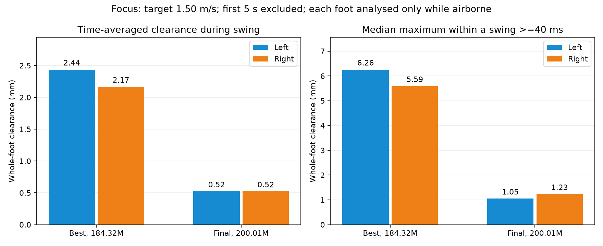
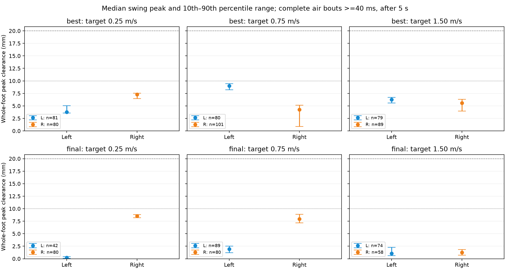
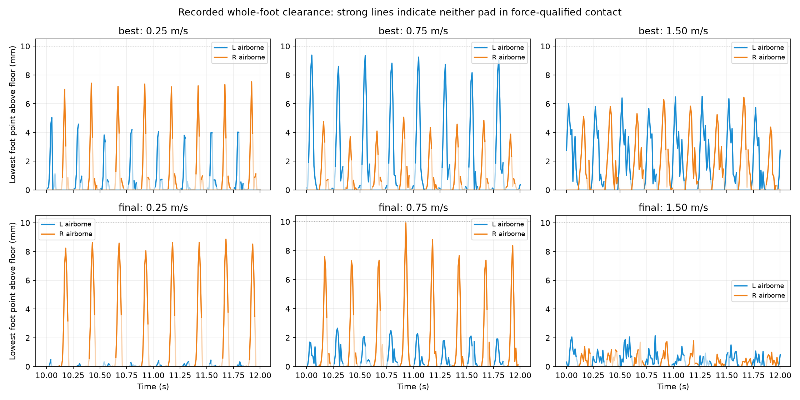

# Flat-feet v1: swing clearance, focus on 1.50 m/s

**26 October update:** CLEARANCE-01 finished 50.01M fine-tuning steps. Matched
12-trial evaluations show mean airborne clearance rising from **2.46/2.25 mm**
to **23.62/20.91 mm** left/right. All final trials survive, but mid-swing
threshold coverage is still below the qualification requirement.
[New videos and clearance graphs](clearance01-videos.html) ·
[experiment results](../docs/clearance01-experiment-report.md).
The original baseline measurements below are retained unchanged.

25 October 2026. Baseline measurement before choosing an extra foot-lift training
constraint. No reward changes or new training were performed for this analysis.

## Focus: 1.50 m/s

The current analysis and next training discussion focus on **target speed 1.50 m/s**.
Both checkpoints are retained for comparison. Heights are measured at the lowest
point of the whole sole, accounting for foot orientation.

### Mean clearance during swing

**Mean clearance** is the time average of whole-foot height over samples where
that foot is airborne. Stance samples are excluded, as are the first five seconds.
It includes short airborne bouts and the low clearance near liftoff/touchdown.
It is not the average of swing peaks. All values below are millimetres.

| Checkpoint | Mean left | Mean right | Pooled mean, both feet |
|---|---:|---:|---:|
| Best, 184.32M | **2.44 mm** | **2.17 mm** | **2.31 mm** |
| Final, 200.01M | **0.52 mm** | **0.52 mm** | **0.52 mm** |

The pooled mean weights each foot by its airborne observation time. For the best
checkpoint, that is 10.70 s left and 9.94 s right. For the final checkpoint, it is
7.09 s left and 5.85 s right. The analysis window is 5-25 s for best and
5-19.22 s for final, ending at its symmetry termination.

### Peak clearance for context

| Checkpoint | Typical left peak | Typical right peak | Largest observed left / right |
|---|---:|---:|---:|
| Best, 184.32M | 6.26 mm | 5.59 mm | 7.05 / 6.92 mm |
| Final, 200.01M | 1.05 mm | 1.23 mm | 4.51 / 3.39 mm |

"Typical peak" is the median maximum in complete swing bouts lasting at least
40 ms. It answers how high a swing usually reaches; the mean answers how far
above the ground the foot stays over airborne time.



For the best checkpoint, **89% of left and 87% of right airborne time is below
5 mm**. For the final checkpoint, both feet remain below 5 mm throughout the
measured airborne samples. At this speed, the best checkpoint combines higher
clearance with a completed 25-second trial; the final checkpoint has lower lift
and ends through the symmetry rule despite accurate average speed tracking.
These are observations from one nominal recording per checkpoint, not repeated-trial
performance guarantees. No new clearance target or training run has been selected.

## What this says about the existing reward

The saved run uses `w_clearance=0.4`, `clearance_dead_m=0.02` and
`clearance_scale_m=0.03`. Its positive clearance component is proportional to
`clip((whole_foot_height - 0.020) / 0.030, 0, 1)`, subject to its swing gates.
All measured post-startup heights are below **20 mm**, so this component is zero
in those windows. This is a reward dead zone below the current threshold, not
evidence that the clearance coefficient was disabled. It also does not prove
that no training episode ever earned the reward.

The existing mid-stance flat-support cost is a separate term. It does not impose
a swing-height target. More balanced contact duration likewise does not establish
adequate geometric clearance: the final 0.75 m/s trial is an example.

## Measurement definition and limits

- Use the exact homing XML from training, verified against its frozen model hash.
  Compute rigid-body forward kinematics from the saved MJX poses. There is no CPU
  dynamics replay and no new stochastic trial.
- For each oriented toe/heel collision box, compute the minimum distance of its
  eight corners to the actual floor plane; whole-foot clearance is the lesser
  of the toe and heel values. The analytic support formula was independently
  checked against explicitly transformed corners at sampled poses in every trial.
- Swing means neither pad has a force-qualified contact, using the recorded
  training threshold of 2 N. This is actual airborne detection, not the scheduled
  swing clock. A lightly loaded pad can fall below that threshold while still
  geometrically touching; force-defined swing therefore does not guarantee a gap.
- The recorder saves pose before a control step and contact after it. Align
  **pose k with contact k-1**. Do not compare pre-step geometry with future contact.
- Small negative distances from soft contact/penetration are retained in the
  trace and signed-minimum statistics. Reported lift heights are clipped at zero.
  Observed signed minima during force-defined swing range down to about -0.64 mm.
- Count all airborne samples for time averages. For peak distributions, exclude
  incomplete boundary bouts and bouts shorter than 40 ms. This does **not** require
  a preceding valid stance, so these bout counts differ from the earlier valid
  step counts. For example, best 0.75 m/s has about 80 left air bouts >=40 ms but
  only one valid completed left cycle after startup under the stricter step rule.
- Input sampling is 100 Hz (10 ms), so sub-tick height peaks can be missed.
  These are single nominal trials at seed 1000, not confidence intervals across
  resets, randomised models or disturbances.
- Each recording lasts 25 s except final 1.50 m/s, which ends at its first
  symmetry termination at 19.22 s. No samples after reset enter the analysis.

## Data and reproduction

- [1.50 m/s summary CSV](data/flatfeet-clearance/summary-1.50mps.csv).
- [Full summary CSV](data/flatfeet-clearance/summary.csv): means, medians, maxima,
  peak percentiles, bout counts and fractions above 5/10/15/20 mm.
- [Summary JSON and input hashes](data/flatfeet-clearance/summary.json).
- [Every measured swing bout](data/flatfeet-clearance/swing-bouts.csv), including
  duration, peak, separate toe/heel maxima and boundary-completeness flags.
- [Signed pad-height/contact traces](data/flatfeet-clearance/clearance-traces.npz).
- [Policy videos](flatfeet-videos.html) and
  [original experiment report](../docs/flatfeet-symmetry-v1.md).

Reproduce locally:

```powershell
.venv/Scripts/python RLframework/tools/measure_swing_clearance.py
```

## Supplementary measurements at all recorded speeds

**Whole-foot lift is generally below 10 mm**, and is strongly asymmetric in some
conditions. All heights below are **millimetres**, measured from the lowest point
of either sole pad to the floor. These are not toe-centre heights.

The first five seconds are excluded. "Typical peak" is the median maximum within
a complete airborne bout lasting at least 40 ms. "Mean during air" averages all
force-defined airborne samples, including short contact interruptions.

| Checkpoint | Target speed | Typical peak left | Typical peak right | Mean during air left | Mean during air right |
|---|---:|---:|---:|---:|---:|
| Best, 184.32M | 0.25 m/s | 3.78 mm | 7.31 mm | 1.48 mm | 2.75 mm |
| Best, 184.32M | 0.75 m/s | 9.00 mm | 4.28 mm | 3.13 mm | 1.63 mm |
| Best, 184.32M | 1.50 m/s | 6.26 mm | 5.59 mm | 2.44 mm | 2.17 mm |
| Final, 200.01M | 0.25 m/s | 0.24 mm | 8.51 mm | 0.14 mm | 4.11 mm |
| Final, 200.01M | 0.75 m/s | 1.91 mm | 7.95 mm | 0.82 mm | 2.60 mm |
| Final, 200.01M | 1.50 m/s | 1.05 mm | 1.23 mm | 0.52 mm | 0.52 mm |

The final checkpoint's left foot at 0.25 m/s never exceeds **0.51 mm** whole-foot
clearance in the analysed window. Its right foot reaches **9.33 mm**. Across all
six recordings, the largest measured whole-foot clearance after startup is
**10.14 mm** (best checkpoint, left foot, target 0.75 m/s).



Points show median peaks; whiskers span the 10th-90th percentiles. The 10 mm and
20 mm lines are scale references, not proposed or implemented targets. Counts
in the legends are airborne bouts meeting the 40 ms duration threshold.



Strong coloured segments indicate actual force-defined swing; faint segments
show the full geometric trajectory. Both use the same lowest-point definition.
