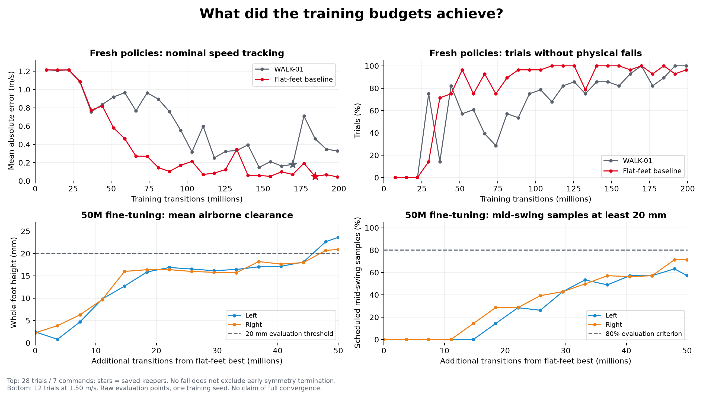
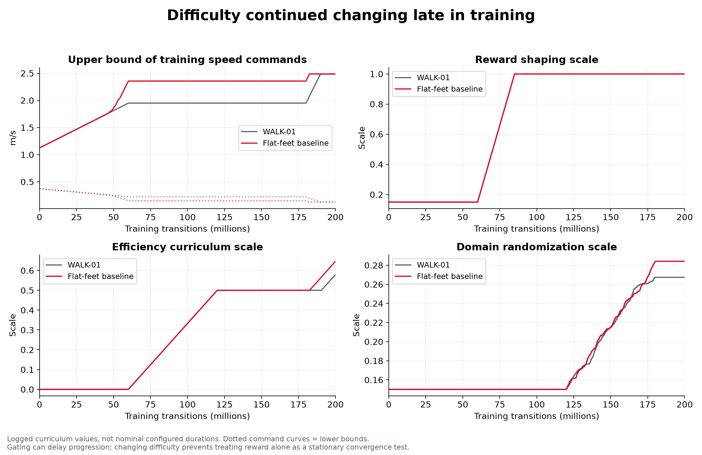
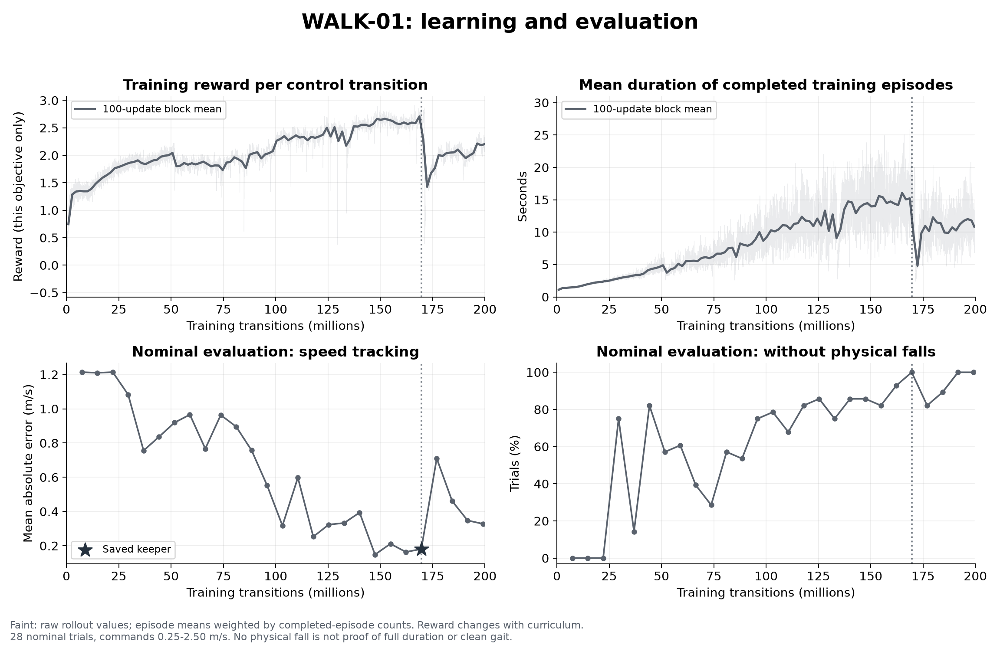
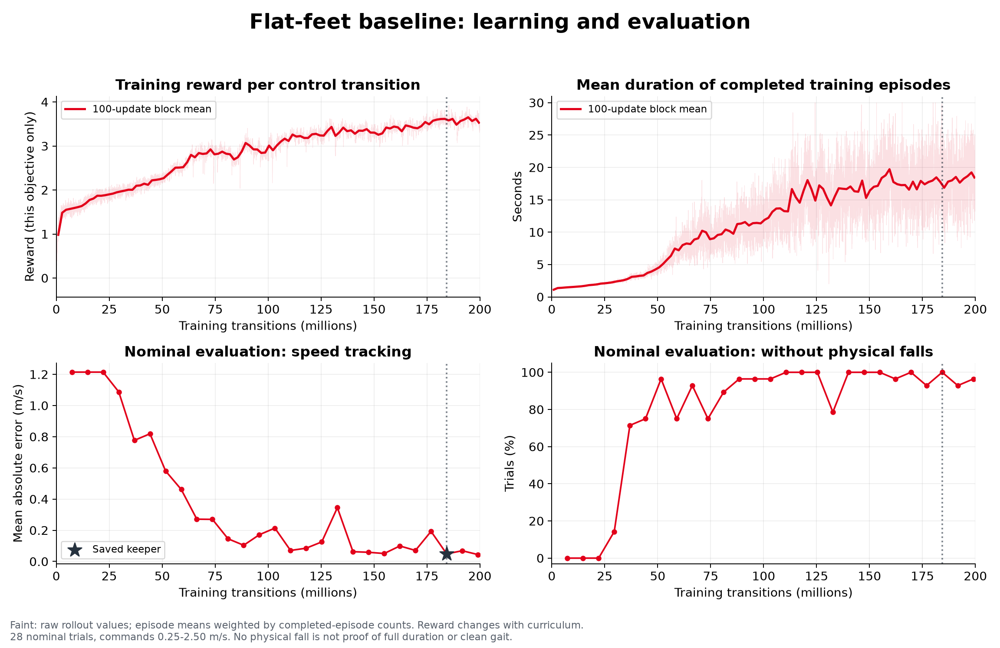
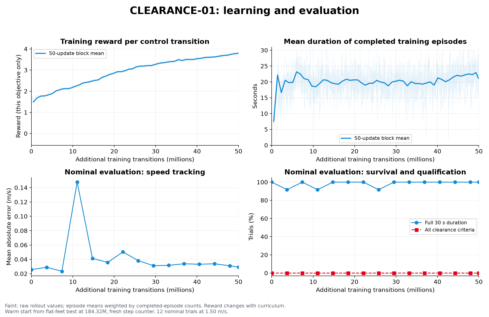

# Learning curves and training budgets

Built from archived local metrics on 27 October 2026. No training or cluster monitoring was performed.

The curves support allowing long training budgets for exploration and curriculum progression. They do **not** establish that 200M steps is optimal, or that these policies have fully converged.



[Slide-ready PNG](figures/learning_curves_overview.png) · [Vector PDF](figures/learning_curves_overview.pdf) · [Editable SVG](figures/learning_curves_overview.svg)

## Evidence for the budgets

| Run | Total transitions | First evaluated checkpoint with zero physical falls | Selected saved keeper | Keeper error |
|---|---:|---:|---:|---:|
| WALK-01 | 200.01M | 169.57M | 169.57M | 0.1809 m/s |
| Flat-feet baseline | 200.01M | 110.59M | 184.32M | 0.0489 m/s |

**Metric correction:** the archived evaluator defines `alive_frac = 1 - physical_falls / n`. A symmetry termination can end a trial early without being counted as a physical fall. Therefore the periodic curves show **trials without physical falls**, not certified full-duration survival. Both selected keepers have a mean of 2,500 evaluated post-warmup ticks, the maximum after the 5 s warmup in a 30 s trial; this supports full duration for all 28 trials at those two checkpoints. It does not certify clean, symmetric walking.

Neither fresh run had an evaluation with zero physical falls by 100M transitions. For the flat-feet run, the lowest evaluated speed error among checkpoints without physical falls was 0.0588 m/s by 150M and 0.0489 m/s at 184.32M (about 17% lower). The last periodic checkpoint at 199.07M had a lower error, 0.0442 m/s, but one physical fall. More training is not monotonically better; retaining a validated keeper matters.

| Run | Budget | Last evaluation within budget | Speed error | Trials without physical falls |
|---|---:|---:|---:|---:|
| walk01 | 50M | 44.24M | 0.8367 m/s | 82.1% |
| walk01 | 100M | 95.85M | 0.5538 m/s | 75.0% |
| walk01 | 150M | 147.46M | 0.1485 m/s | 85.7% |
| walk01 | 200M | 199.07M | 0.3279 m/s | 100.0% |
| flatfeet | 50M | 44.24M | 0.8189 m/s | 75.0% |
| flatfeet | 100M | 95.85M | 0.1712 m/s | 96.4% |
| flatfeet | 150M | 147.46M | 0.0588 m/s | 100.0% |
| flatfeet | 200M | 199.07M | 0.0442 m/s | 96.4% |

These are the last evaluations within each budget, **not** a cumulative best curve. All raw evaluation points remain visible in the figures. The CSV also includes the lowest-error checkpoint without physical falls within each budget; this diagnostic is not the actual keeper rule (which also uses heading and other criteria).

## Why the curriculum needs time



Both fresh runs reached a shaping scale of at least 0.99 at 84.75M and an efficiency scale of at least 0.5 at 120.05M. The upper command bound reached 99% of its 2.5 m/s maximum only at 189.63M in WALK-01 and 182.22M in flat-feet. These are observed first threshold crossings, not proof that a curriculum completed or stayed there. Gated curricula can advance much later than their nominal configured step durations. A short run would train on a different difficulty mix.

## The 50M clearance experiment was still changing

At 1.50 m/s, mean whole-foot clearance while airborne increased from **2.46/2.25 mm** to **23.62/20.91 mm** (left/right). The curves continue changing in the last several million transitions. Final scheduled mid-swing coverage above 20 mm is **57.2%/71.4%**, below the 80% criterion for each foot. All 12 nominal trials reach 30 s, but none satisfies all clearance criteria. Good mean height alone does not establish consistent swing clearance.

This is **50M additional transitions** from flat-feet's selected 184.32M checkpoint. The plotted counter restarts at zero; it is not fresh training. It supports testing a larger fine-tuning budget, while the new CLEARANCE-02 reward uses different 10–25 mm thresholds. Its 200M budget is an experimental allowance, not an already demonstrated requirement. The first CLEARANCE-02 attempt performed no main training, so it has no learning curve to include.

## Detailed learning curves

### WALK-01



[PNG](figures/learning_curves_walk01.png) · [PDF](figures/learning_curves_walk01.pdf) · [SVG](figures/learning_curves_walk01.svg)

### Flat-feet baseline



[PNG](figures/learning_curves_flatfeet.png) · [PDF](figures/learning_curves_flatfeet.pdf) · [SVG](figures/learning_curves_flatfeet.svg)

### CLEARANCE-01



[PNG](figures/learning_curves_clearance01.png) · [PDF](figures/learning_curves_clearance01.pdf) · [SVG](figures/learning_curves_clearance01.svg)

## What a step means

One step is one control transition for one simulated robot at **100 Hz** (10 ms). There are **512 parallel environments**, each collecting 36 control ticks per rollout: **18,432 transitions per PPO update**. The 200M requests round up to **200,005,632 transitions / 10,851 updates**; 50M rounds up to **50,006,016 / 2,713 updates**. These are neither episode counts nor optimizer minibatch counts. PPO reuses each rollout over multiple epochs.

200M transitions correspond to roughly **556 pooled simulated hours**, or about **65 simulated minutes per environment**, spread across many resets. The physics advances in 1 ms substeps. Simulation time, GPU wall time and the number of independent training seeds are different quantities.

## Plotting and evaluation protocol

- Fresh runs: 28 nominal first episodes, four trials at each command 0.25, 0.50, 0.75, 1.00, 1.50, 2.00 and 2.50 m/s; 30 s maximum, first 5 s excluded from speed error. Evaluations every 400 rollouts (7.3728M transitions). No initial zero-step evaluation is available.
- CLEARANCE-01: 12 nominal first episodes at 1.50 m/s, including a matched zero-step baseline and final evaluation. The custom JSONL records full-duration survival separately from physical falls.
- Evaluation points are unsmoothed. Lines only connect sampled checkpoints. The same nominal evaluation protocol/seed is reused for selection; this is not an independent held-out robustness study.
- Faint training curves are raw rollout logs. Bold curves use non-overlapping block means: 100 updates (1.8432M transitions) for fresh runs, 50 updates (0.9216M) for fine-tuning. Final partial blocks are retained. Completed-episode duration means are weighted by episode count; rollouts with no completed episodes are excluded from that duration average.
- Reward is the average per control transition, not cumulative episode return. Reward definitions differ between runs and curricula change within runs, so scalar reward levels cannot rank the policies or by themselves prove convergence.
- At 14,321,664 CLEARANCE-01 transitions, several clearance diagnostics are non-finite while the rollout mean reward is finite. The source logs are preserved; no interpolation or data repair is performed. The clearance curves here use separate finite evaluation records.
- One training seed per run. No confidence intervals, optimal-budget claim or convergence-rate significance claim is supported. Nominal survival/tracking does not rule out sliding, contact chatter, gait asymmetry, startup failures in other replay setups, or a sim-to-real gap.

## Suggested presentation wording

> We allowed 200 million pooled control transitions because the fresh policies and gated curricula were still developing beyond 100 million. The flat-feet baseline's selected checkpoint was reached at 184 million transitions. The 50-million-transition clearance fine-tuning showed that foot lift could improve, but it was still changing and had not met all clearance criteria. These curves justify the experimental budgets; they do not prove full convergence or that more training is always better.

## Reproduce and trace the data

```powershell
.venv/Scripts/python report/scripts/build_learning_curves.py
```

[Summary and input SHA-256 hashes](data/learning-curves/summary.json) · [Budget milestones CSV](data/learning-curves/budget_milestones.csv) · [Periodic evaluations CSV](data/learning-curves/periodic_evaluations.csv) · [Clearance evaluations CSV](data/learning-curves/clearance_evaluations.csv)

Original per-run `progress.csv`, `eval.csv`, `resolved_config.json`, selected `best_eval.json` and `clearance_evaluations.jsonl` remain under `docs/experiments/`. Input hashes are verified unchanged after generation. Existing presentations are untouched.
