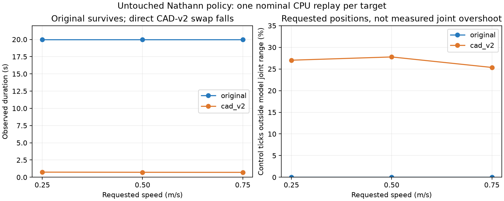

# Nathann policy transfer: original robot versus CAD-v2

19 October 2026. [Video comparisons](policy-transfer01-videos.html).

## Outcome

The unchanged original policy survives all three 20-second nominal replays on
its original model. A direct CAD-v2 swap falls in 0.71–0.74 seconds. Replacing
the controller's command bounds with CAD-v2 limits, or additionally shifting
its observation zero and nominal target by the reset-angle difference, does
not prevent the fall. No policy training or SCITAS job was launched.

| Requested speed | Original: duration / mean world-X speed | CAD-v2: fall time | CAD-v2 ticks requesting out-of-range positions |
|---|---|---|---|
| 0.25 m/s | 20 s / 0.524 m/s | 0.74 s | 27.0% |
| 0.50 m/s | 20 s / 0.590 m/s | 0.72 s | 27.8% |
| 0.75 m/s | 20 s / 0.654 m/s | 0.71 s | 25.4% |

The original replay reproduces sustained locomotion, not accurate speed tracking
at every requested speed. Do not describe the requested speed as the achieved
speed. The short CAD-v2 fall's forward displacement is not sustained locomotion.



## Source and protocol

Bundle: `controller/deploy/bundles/dash_joy3_lr_s2_180M.npz`, exported at
180,486,144 steps. Its Git blob matches fetched `upstream/main`:
`15be958c25164e9654de33d0ee922018526b7735`.
The original `RLframework/model/dash01_free.xml` also matches upstream:
`4ddc555c8a29e16467f7b39379e5b0017388fba7`.

CPU MuJoCo through the existing NumPy deployment controller, 100 Hz control,
1 kHz physics and original 12 ms command delay. Same actor, velocity estimator,
normalization, gait decoder, motor envelope and speed commands. No balance rail,
no learning, no new reward. Each model uses its own reset keyframe and physical
joint limits. The direct swap retains the original controller's command bounds
and logs any incompatibility instead of silently changing the policy's actions.

One deterministic nominal reset per condition. End the trace at the first
nonfinite state or the existing deployment replay's fall criterion
(upright cosine below 0.3 or base height below 0.45 m). This is not the stricter
SPEED-01 evaluator, a multi-seed robustness test, or a hardware test.
Videos hold the terminal pose with a clear label; they do not show auto-resets.
Foot colors are presentation-only.

## Compatibility findings

Both models expose the same six actuator names and approximately matching local
motor axes. This rules out an obvious actuator-order or axis-sign mismatch,
but does not prove that equal joint coordinates produce equal foot trajectories.
The internal position-coordinate counts differ (16 versus 20).

Total model mass is 14.356 kg versus 14.594 kg. Hip-roll limits narrow from
approximately ±45° to ±25°, and cam limits from ±86° to ±34°. Thigh bounds and
the reset pose differ too. The old policy requests left cam positions up to
0.285 rad beyond the new limit and left thigh positions up to 0.151 rad beyond
the new limit. Actual sampled motor positions stay within limits in these short
replays: requesting an unreachable target is distinct from physically crossing
the limit.

Diagnostic ablations, unchanged network weights:

| Adapter | Fall times at 0.25 / 0.50 / 0.75 m/s |
|---|---|
| CAD-v2 command bounds only | 0.74 / 0.71 / 0.71 s |
| Bounds plus reset-relative observation/target shift | 0.75 / 0.73 / 0.72 s |

Both eliminate recorded out-of-range target commands without restoring survival.
The reset-relative shift is only a heuristic, not a measured CAD frame transform.
These tests show that clamping or simple reset offsets alone are insufficient;
they do not identify the full cause of the failure or prove transfer learning
cannot succeed.

## Next decision

Inspect the original gait first to establish whether it is actually the desired
demonstration gait. Then compare old/new foot trajectories and body motion for
the same motor commands, including linkage geometry and support at reset. Use
that evidence to design a mapping that respects CAD-v2 joint limits, or a gradual
adaptation curriculum. Preserve the original actor and normalization as the
reference. A long fine-tune has not yet been justified by this direct-transfer
test.

## Reproduce and records

```powershell
.venv/Scripts/python RLframework/tools/policy_transfer_replay.py
.venv/Scripts/python RLframework/tools/policy_transfer_replay.py --adapters
.venv/Scripts/python RLframework/tools/policy_transfer_replay.py --render
.venv/Scripts/python report/scripts/build_policy_transfer_assets.py
```

[Paired metrics and model audit](data/policy-transfer01/results.json),
[adapter results](data/policy-transfer01/adapter-probes.json),
[source/trace/video hashes](data/policy-transfer01/manifest.json).
Compressed pose traces are retained beside the metrics.
