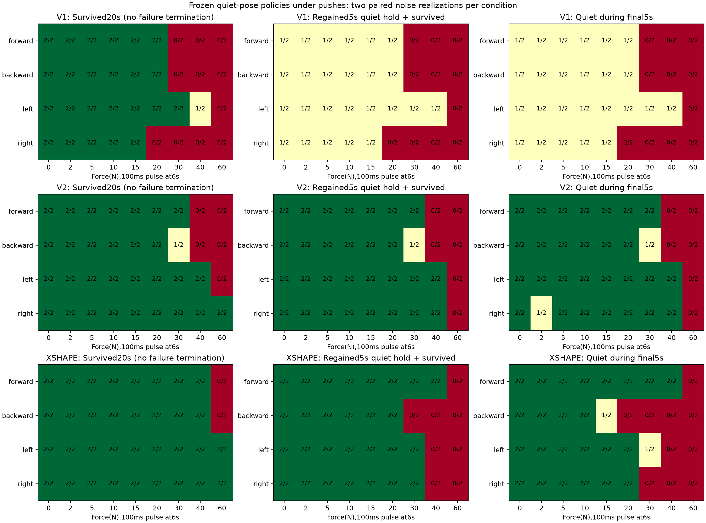
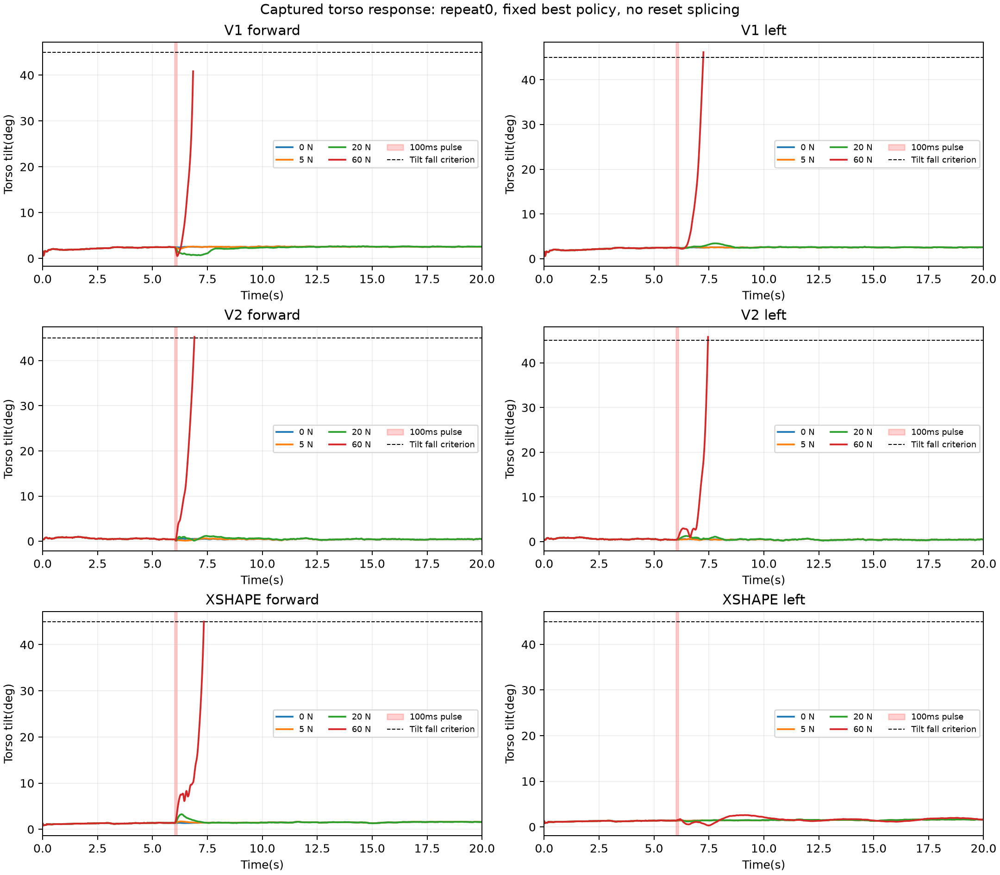

# Push-only simulations of the best quiet-pose policies

No training: the saved best checkpoint for each model is fixed. Independent 20 s
trials start from its quiet reference, with full sensor noise, no physical DR.
One 100 ms horizontal pulse acts at the torso COM at 6 s. Forces: 0, 2, 5, 10,
15, 20, 30, 40 and 60 N; four body-horizontal directions, two paired noise
realizations, 66 trials/model (198 total).
Each force/direction uses the same pre-push noise stream within a repeat.

Impulse is force multiplied by pulse duration: 60 N for 100 ms delivers 6 N s.
The CSV's nominal delta-v is impulse divided by model mass, an equivalent
free-body velocity change; it is not measured walking speed.

Foot lifts, contact changes and drift do not terminate this diagnostic. Physical
fall (45-degree tilt or low torso), invalid numerics or serious floor-contact/penetration
failure terminate. Post-push quiet must last five continuous seconds with sufficient
loaded contact; posture tolerances stay identical to QUIET-01v2. No fixed return deadline.
Survival, a regained hold and a final quiet window are separate results.

Cells show observed counts out of two, not a statistically established safety limit.
Zero-force controls are reused in the four direction rows, not four independent sets.
Check pre-push readiness and controls before attributing a failure to the force.
A contact landing event alone does not establish a useful recovery step.

| Model | Selected checkpoint (M additional) | Zero-force survival | Zero-force final hold | Weights unchanged |
|---|---:|---:|---:|---|
| V1 | 66.36 | 2/2 | 1/2 | True |
| V2 | 100.01 | 2/2 | 2/2 | True |
| XSHAPE | 58.98 | 2/2 | 2/2 | True |

A zero-force trial can already miss the strict posture hold. CSV columns
`paired_control_retained` and `lost_retention_vs_control` distinguish that
baseline behavior from a new loss under a push. These are paired observations,
not significance estimates. The same applies to upright survival.

Observed first survival misses on this coarse ladder (counts include numerical/
contact failures separately recorded in the CSV):

| Model | Forward | Backward | Left | Right |
|---|---|---|---|---|
| V1 | 20N both survive; first miss30N | 20N both survive; first miss30N | 30N both survive; first miss40N | 15N both survive; first miss20N |
| V2 | 30N both survive; first miss40N | 20N both survive; first miss30N | 40N both survive; first miss60N | Both survive through60N |
| XSHAPE | 40N both survive; first miss60N | 40N both survive; first miss60N | Both survive through60N | Both survive through60N |

## Behavioral interpretation

Upright survival and successful posture recovery are different capabilities.
V2 is comparatively consistent at returning to the reference under moderate
pushes. X-shape survives large lateral pushes, but at60N neither lateral
direction regains the quiet reference hold in either repeat. The same happens
for V2 with60N rightward pushes. This is survival, not full recovery.

These surviving60N lateral cases have only about0.0–0.1mm whole-foot clearance
(minimum sole gap) while sole centers move roughly74–109mm. Loaded contact
slip peaks about0.46–0.81m/s in the affected foot. Grounded slipping/shifting
is therefore present; contact landing counts do not demonstrate a clean
recovery step. This test permits such motion so the behavior remains visible.

The45deg tilt criterion ends a trial before literal ground impact; interpret
the videos as reaching the stated fall criterion, not a measurement of
physical ground contact for every fall. No hardware or general safety limit
is inferred from two noise realizations and a single pulse duration.

[Video gallery](quiet-push01-videos.html). Raw per-trial CSV and JSON, measured delivered
impulse, torso tilt, foot displacement, clearance, contact events and torque utilization
are under `report/data/quiet_push01/{model}/`. CPU-MJX backend, float32; no policy updates.
