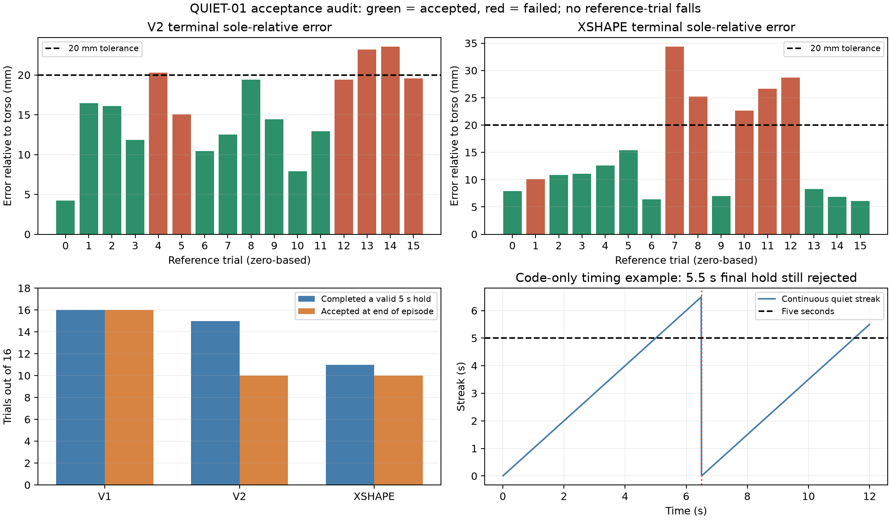
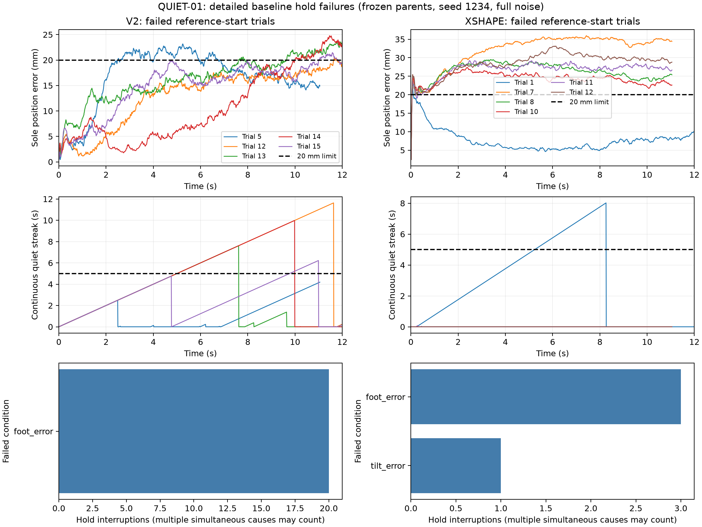

# QUIET-01: inspection of quiet-pose hold failures

**Detailed replay completed and archived,23November:** diagnostic3263170 tasks
all exit0. Traces, per-condition interruption plots and matched controls are now
in the generated section at the end. V2 replays11/16 versus original10/16;
this variation is retained. The new v2 training also completed; see its
[results](quiet01-v2-results.md). Historical v1 controls are not new-policy results.

**Subsequent correction and resubmission:** [QUIET-01 v2](quiet01-v2-pose-tracking.md),
preflight3263184 and dependent training3263185. This page retains the original
v1 diagnosis; pending diagnostic3263170 still uses the frozen v1 implementation.

22 November 2026. No task/reward changes or new training during this inspection.
Sources: original preflight baseline records, frozen source, a reproducible hold-rule
example, and a queued diagnostic replay. Distinguish confirmed results from pending traces.

## What failed

The 62.5% reference success for V2/X-shape is **final episode acceptance**, not
the fraction capable of ever completing a valid five-second hold.

| Model | Completed a valid 5 s hold | Accepted at episode end | Failed after completing a hold | Never completed a hold | Physical falls |
|---|---:|---:|---:|---:|---:|
| V1 | 16/16 | 16/16 | 0 | 0 | 0 |
| V2 | 15/16 | 10/16 | 5 | 1 | 0 |
| X-shape | 11/16 | 10/16 | 1 | 5 | 0 |

Completion follows the existing `settling_s >= 0` field, set only after the code
observes five seconds of quiet, acceptable posture and adequate loaded contact,
with a timely start. These are exact-reference starts, zero initial velocity,
full measurement noise, no pushes. They do not establish randomized-start robustness.

## Confirmed timing restriction

`BalanceRL/quiet_tracking_math.py:hold` checks a five-second streak AND
`current_time - streak <= 6 s`. `BalanceRL/quiet_tracking.py` records the first
completion in `pose_succeeded`, but final acceptance additionally requires
`truncated & quiet_ok & pose_succeeded` at the full 12-second episode end.

A previous successful hold therefore does not guarantee episode success. The
final streak must ALSO have started by six seconds. At the 12-second endpoint
this effectively requires about **six continuous seconds**, stricter than simply
returning and holding five seconds. Return timing and final retention are coupled.

Reproduced code-only example: quiet and loaded, complete the first five-second
hold, interrupt quiet for one 10 ms tick at 6.50 s, then remain perfectly quiet
and loaded through 12 s. The final streak is **5.50 s**, yet `quiet_ok=False`
because it began at 6.50 s. This proves the extra restriction; it does not prove
this exact time pattern occurred in any particular rollout.

Five V2 failures and one X-shape failure had already completed a timely valid
hold. Detailed traces are still needed to identify each subsequent interruption.

## Measured posture errors

The main visible issue is **20 mm sole-position error relative to the torso**.
This is neither clearance nor a direct measurement of floor sliding. A torso
shift over planted feet can change this quantity.

- V2 failed trials 4, 13 and 14 end at **20.29, 23.19 and 23.53 mm**, above the
  20 mm tolerance. Trials 12 and 15 end at **19.39 and 19.56 mm**, below that
  individual limit, yet fail final acceptance. Their precise final blockers need
  traces: passing one limit does not imply all hold conditions pass. Trial 5
  never completes a hold and times out at **11.05 s**.
- X-shape trials 7, 8, 10, 11 and 12 never complete a hold and time out at
  **11.05 s**. Terminal sole errors are **34.33, 25.19, 22.63, 26.68 and 28.66 mm**.
  Trial 7 also exceeds 1.5-degree motor RMS, ending near **1.71 degrees**.
  Trial 1 previously completes a hold but ends with gravity-direction error
  **1.74 degrees**, above the 1.5-degree limit.
- Every model has **zero physical falls** among its reference trials.

The parent policies were trained for the previous standing/recovery objective,
which did not require this precise fixed posture. Small persistent reference
errors are plausible. The terminal measurements alone do not establish whether
sensor bias, the changed reset pose or learned behavior causes the drift.

## Preflight and recommended changes

The assertion requires the **old parent** to pass at least75% of the new strict
reference task before learning. That is a performance gate, not a numerical check.
The reset/native/GPU checks pass. Requiring the old policy to have already learned
the new objective can prevent the training meant to teach it.

Recommended before resubmitting:

1. Define training success as reach the target within the return window, then
   hold five continuous seconds. End the episode on completion or retain that
   completion explicitly. Test longer quiet retention separately, without
   coupling its final window to the original first-return deadline.
2. Keep reference attraction, contact checks, slip and effort costs. These results
   do not justify changing the model or increasing generic penalties. Sole-relative
   errors are not evidence of slipping, motor failure or an inability to stay upright.
3. Keep numerical/physical preflight checks distinct from the learning objective.
   Let a valid parent undergo a short conservative pilot even if it has not mastered
   the new tolerance; compare baseline/pilot with the SAME seeds. Preserve strict
   target criteria for reporting and curriculum advancement after learning.

No recommended correction is implemented during this inspection.

## Detailed replay: completed, no learning

Diagnostic array **3263170**: three frozen-parent replays, maximum20min allocation
each. Record every hold condition at100Hz, first16 reference trials of the original
96-member seed1234 batch. Four paired cases: reference/noisy measurements,
reference/no measurement noise, original keyframe/noisy measurements, and
keyframe/no measurement noise. No optimizer updates or changed frozen task code.
Replay parity with archived pass/fail decisions will be reported, not assumed.

The original helper reached its8h bound before fetch completion. On23November,
after confirming all diagnostic tasks completed, it was rerun once and fetched
all traces and generated the results below. It never starts/resubmits training.
Its status is now`complete` in
`report/data/quiet01/hold-diagnostics/pipeline.json`.

## Evidence

[Original reference records](data/quiet01/reference-hold-evidence.json),
[per-trial CSV](data/quiet01/reference-hold-audit.csv),
[timing example and counts](data/quiet01/hold-rule-audit.json).
`report/scripts/build_quiet01_hold_audit.py` reproduces the current audit.
`diagnose_quiet01_holds.py` records the frozen-parent traces;
`analyze_quiet01_holds.py` appends detailed results;
`finish_quiet01_hold_diagnostics.py` fetches the bounded diagnostic job.

<!-- detailed-diagnostic-results -->

## Detailed matched-seed diagnostic replay

Frozen-parent replay array **3263170**, seed1234, original96-member layout.
There are no training updates. Controls change the initial pose and sensor
noise only; model dynamics, policy weights and reference target are fixed.

| Model | Reference + noise | Reference, no noise | Keyframe + noise | Keyframe, no noise |
|---|---:|---:|---:|---:|
| V1 | 16/16 | 0/16 | 9/16 | 0/16 |
| V2 | 11/16 | 0/16 | 14/16 | 0/16 |
| XSHAPE | 10/16 | 16/16 | 1/16 | 0/16 |

Replay parity with archived baseline outcomes:
- V1: True.
- V2: False.
- XSHAPE: True.

Exact per-condition hold interruptions for failed reference trials:
(multiple conditions can fail on the same tick).
- V1: no interruptions counted in failed trials.
- V2: foot_error=20.
- XSHAPE: tilt_error=1, foot_error=3.

[Per-trial numeric measurements](data/quiet01/hold-diagnostics/per-trial.csv),
[complete analysis](data/quiet01/hold-diagnostics/analysis.json).
No claim about improved policy weights follows from these controls; they are
diagnostic rollouts with the original parents. This section is generated from
the saved numerical traces. This diagnostic job does not train; see the
[v2 correction and resubmission](quiet01-v2-pose-tracking.md) for subsequent work.
