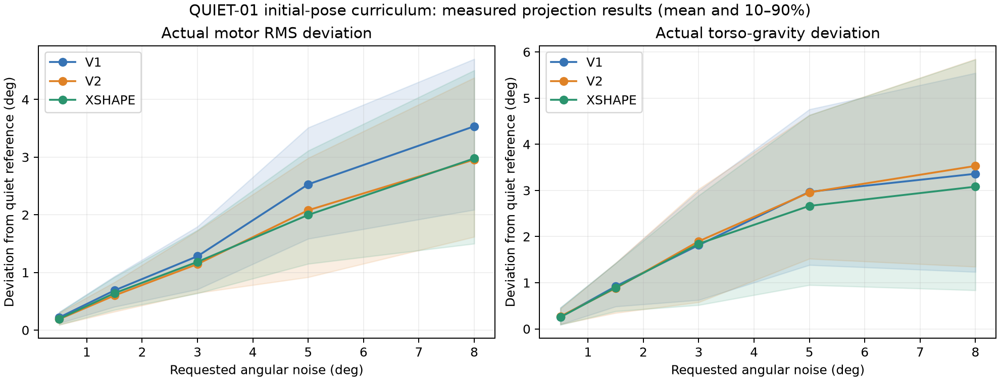

# QUIET-01: return to the learned quiet-standing posture

**Hold failures inspected:** [acceptance audit and diagnosis](quiet01-hold-diagnosis.md).
V2 completed a valid five-second hold in15/16 reference trials, X-shape11/16;
both were accepted only10/16 at episode end. Timing/final-retention criteria add
an extra restriction. No task changes or new training; detailed replay3263170 queued.

**Status checked 22 November, 16:18 CET: training did not start.** V1 passed GPU
preflight, while V2 and X-shape failed the parent-reference success gate (10/16
each, below the 12/16 minimum). Dependent training array 3263104 was cancelled
before allocating training time. See the status-check section below. No resubmission.

Prepared 22 November 2026. This task takes priority over stronger pushes and recovery stepping.
The earlier STAND-05 push/posture-return task remains available but is not used here.

## Objective and initialization

Run V1, V2 and X-shape in parallel. Each starts from its own frozen STAND-04 best
policy and observation normalizer, with fresh optimizers, counters and curriculum.
Use the existing model-specific `BalanceRL/model/quiet_*.json` references, selected
from actual successful quiet rollouts. Track motor positions, torso gravity,
body-frame sole positions and torso height above the soles. World XY and heading
are not targets. The action/observation dimensions and motor/drive model are unchanged.

There are no pushes, operator hold, reset velocities, physical domain randomization,
reflex or walking objective in this stage. The inherited sensor measurement noise
remains enabled at full scale. This isolates initial-posture recovery; it does not
establish robustness to pushes, initial velocities or unmodeled hardware effects.

## Physically consistent initial postures

`BalanceRL/tools/build_quiet_resets.py` uses native MuJoCo kinematics and constrained
least-squares projection around each recorded reference. Both feet begin with at
least one sole corner at the floor, allowing heel/toe rocking. The generator does
not require both complete soles to be flat while independently perturbing torso
and leg angles: that would overconstrain the closed leg mechanisms.

Nominal angular-noise requests are 0.5, 1.5, 3, 5 and 8 degrees. Projection changes
the achieved deviations, so report actual joint RMS rather than calling these
exact joint or torso offsets. Mostly bilateral requests plus smaller independent
left/right deviations preserve a plausible initial footprint. Passive hinges are
solved with the motor joints and torso pose, rather than independently jittered.

Accepted poses satisfy joint limits, maximum loop-site error below 0.1 mm, lowest
corner of each foot within 0.15 mm of the -0.1 mm contact-compliance offset, and
centered footprint error below 15 mm per foot. A common XY shift of both feet
relative to the torso is allowed: the task must bring the body back over the feet,
at whichever floor location they occupy. Each accepted pose has a nontrivial
motor RMS deviation of at least 15% of its requested noise level.

Each model has 320 training starts (64 per level), 80 independent probe starts
(16 per level) and 80 independent test starts. All splits have separate seeds and
are checked for duplicates. Arrays and model/reference hashes are saved in
`BalanceRL/model/quiet_resets_*.npz`. Zero velocity is applied at every reset;
there is no settling rollout or hidden stabilizer during reset.

## Reward and task verdict

The main attraction is `3 * exp(-E)` where E combines squared motor RMS error,
gravity-angle error, mean squared body-frame sole error and height error, divided
by scales 0.10 rad, 0.10 rad, 40 mm and 30 mm respectively. A separate bounded
posture-error penalty keeps a gradient farther from the target. These terms are
active during motion; returning does not wait for a push-recovery phase.

Per control tick the additional terms are alive 0.5, upright up to 0.5, actual
loaded-contact support up to 0.5, and a quiet bonus up to 2 **only when posture is
within tolerance and both feet are loaded**. Quiet bonus decays with body, angular
and motor velocity. Costs remain for actual contact sliding, torque utilization,
action changes, gain, joint limits and modest foot drift. Missing flat support has
only a small cost near the target; heel/toe rocking is allowed during the return.
Reward contributions are logged separately. Five-second hold completion pays a
single +2, physical failure costs -20, task violation costs -5.

Success requires all of the following for five continuous seconds, beginning by
six seconds, and a valid final hold at the end of the full 12-second episode:

- Motor error RMS <=1.5 degrees and individual maximum <=3 degrees.
- Gravity-direction error <=1.5 degrees, body-frame sole error <=20 mm,
  torso-height error <=10 mm.
- Body speed <0.05 m/s, angular speed <0.25 rad/s, motor speed RMS <0.30 rad/s,
  loaded-contact slip speed <0.02 m/s, and sole clearance <=3 mm.
- At least 95% of hold ticks have both feet actually loaded (>=2 N each),
  with torso XY movement <=30 mm during the streak.

A temporary single-pad contact loss does not terminate the episode. This first
task targets planted correction: whole-foot clearance >5 mm for >100 ms or sole
center drift >50 mm from the starting footprint is a task violation. Falls,
non-sole floor contact, severe penetration and invalid physics also fail. A
stationary but wrong posture cannot pass, and a later streak cannot extend the
fixed return deadline. This envelope is deliberately limited; larger disturbances
that require a recovery step belong to the subsequent task.

## Curriculum, evaluation and budget

Start at the easiest reset bank. Training mixes 20% exact-reference starts,
30% starts drawn from levels through the current frontier, and 50% frontier starts.
Every 200 updates (~3.69M transitions), run an independent greedy 96-trial probe:
16 reference starts plus 16 at each of the five levels. Advance one level only
after two passing probes: reference >=95%, current frontier >=90%, previous
levels >=80%. With 16 trials this means 16/16 reference and >=15/16 frontier.
Sensor-noise seeds change for each probe. No push curriculum or noise ramp runs.

Separate 96-trial fixed test evaluations every 400 updates (~7.37M transitions)
select the best policy, prioritizing >=95% reference retention before total success
over all levels. Test poses are distinct from training and promotion probes.
Baseline, per-level success, fall/violation rates, settling time and final posture
errors are archived, along with per-update reward/error curves.

Initial budget: **100M additional transitions per model**, maximum 12-hour GPU
allocation with a 10.5-hour training save cutoff. This is a first controlled
posture-recovery experiment, not a claim of convergence at that budget. Full runs
use seed 2 and the `quiet_v1`, `quiet_v2`, `quiet_xshape` presets.

PPO's KL diagnostic now uses the original log-ratio instead of `log(exp(log_ratio))`
to avoid underflow artifacts observed previously. The new task also checks finite
rollouts, losses, weights and optimizer state, and stops further PPO epochs on an
excessive measured KL. This is not a full trust-region guarantee.

## Validation and submission

The pipeline verifies frozen hashes and runs native/logic tests, GPU reset and
no-push checks, a baseline 96-trial evaluation, and a discarded 24-update PPO pilot.
The long training array depends on successful completion of **all three** preflight
tasks and checks their passed receipts before starting. Pilot policies never seed
training. Frozen inputs, scheduler receipts and status live in
`docs/experiments/quiet01_20261122_v1/`.

Submission and validation results will be appended below. No training outcome is
available at preparation time.

Local validation: **29 tests pass** (23 previous contact/recovery/reference checks
and six new hold, curriculum and reset-bank tests), plus Python compilation.
The bank audit checks all 1,440 projected starts across three models and all splits.
Actual mean motor RMS deviations in the training banks are:

| Requested level | V1 | V2 | X-shape |
|---|---:|---:|---:|
| 0.5 deg | 0.22 deg | 0.19 deg | 0.19 deg |
| 1.5 deg | 0.69 deg | 0.60 deg | 0.64 deg |
| 3 deg | 1.28 deg | 1.15 deg | 1.18 deg |
| 5 deg | 2.53 deg | 2.08 deg | 2.00 deg |
| 8 deg | 3.53 deg | 2.96 deg | 2.98 deg |

[Numeric reset audit](data/quiet01/reset-audit.json). These figures describe
training inputs, not achieved robustness or convergence.

## Submitted: 22 November 2026, 13:33 CET

- GPU preflight array **3263103**, one task for each model, maximum one hour.
- Training array **3263104**, three parallel tasks, dependency `afterok:3263103`.
  Task 0 = V1, 1 = V2, 2 = X-shape. If any preflight task fails, Slurm cancels the
  dependent training array; the training script also requires all passed receipts.
- Frozen remote root: `/home/rizkalla/running_robot/experiments/quiet01_20261122_v1`.
- Archive SHA256: `e0a6be8a9a2fd1a44a62581ee535822918e43dec666cbfb657f16748635ea1d3`.
- Additional validation before submission: all three SCITAS CPU abstract reset/step
  traces pass, observation shape `(2, 463)`. Optional Warp import warnings do not
  affect this JAX backend check. This is not a GPU numerical rollout.

[Scheduler receipt](../docs/experiments/quiet01_20261122_v1/submission.json),
[frozen source manifest](../docs/experiments/quiet01_20261122_v1/source-manifest.json),
[local tests](data/quiet01/local-tests.txt), [abstract traces](data/quiet01/abstract-trace.txt).
GPU preflight and training outcomes have **not** been monitored after submission.
The frozen report snapshot in the source archive predates this submission receipt.

## Status check: 22 November 2026, 16:18 CET

Slurm accounting: preflight 3263103_0 completed in 7m35s; _1 failed in 2m52s;
_2 failed in 2m39s. Training 3263104_[0-2] is cancelled with elapsed time zero.
There are no `quiet01_*` training run directories in the frozen experiment root.

| Model | Exact-reference baseline | Baseline all-level score | Preflight outcome |
|---|---:|---:|---|
| V1 | 16/16 | 56/96 | Completed 49,152-step finite PPO pilot |
| V2 | 10/16 | 28/96 | Stopped before PPO: reference rate 0.625 <0.75 |
| X-shape | 10/16 | 40/96 | Stopped before PPO: reference rate 0.625 <0.75 |

All three pass the 29 native/logic tests and GPU reset/no-push checks. The two
failures are task-acceptance assertions, not evidence of a GPU or compilation
crash. None of the exact-reference baseline trials physically falls. V2 has one
task violation among those trials and X-shape five; remaining unsuccessful
reference trials fail to maintain the stricter final reference-posture hold.
This new task is stricter than STAND-04 quiet-standing evaluation, and starts
from the recorded reference rather than the model's previous reset keyframe.
The logs do not isolate which change causes each failure.

V1's discarded short pilot obtains reference success 12/16 and total 49/96 with
seed 4321, compared with 16/16 and 56/96 baseline with seed 1234. Because the
measurement-noise seed changes, this does not establish a training regression or
improvement. Before resubmission, inspect the failed reference holds and compare
baseline/post-pilot with matched seeds. Do not simply lower the gate and claim
robust quiet tracking. No code changes or replacement jobs were made in this check.

Raw logs are archived in `report/data/quiet01/preflight-results/`. The earlier
submission paragraph records the information available at submission time; this
section supersedes its unmonitored status. There are no long-run convergence
curves or new trained-policy videos yet.
