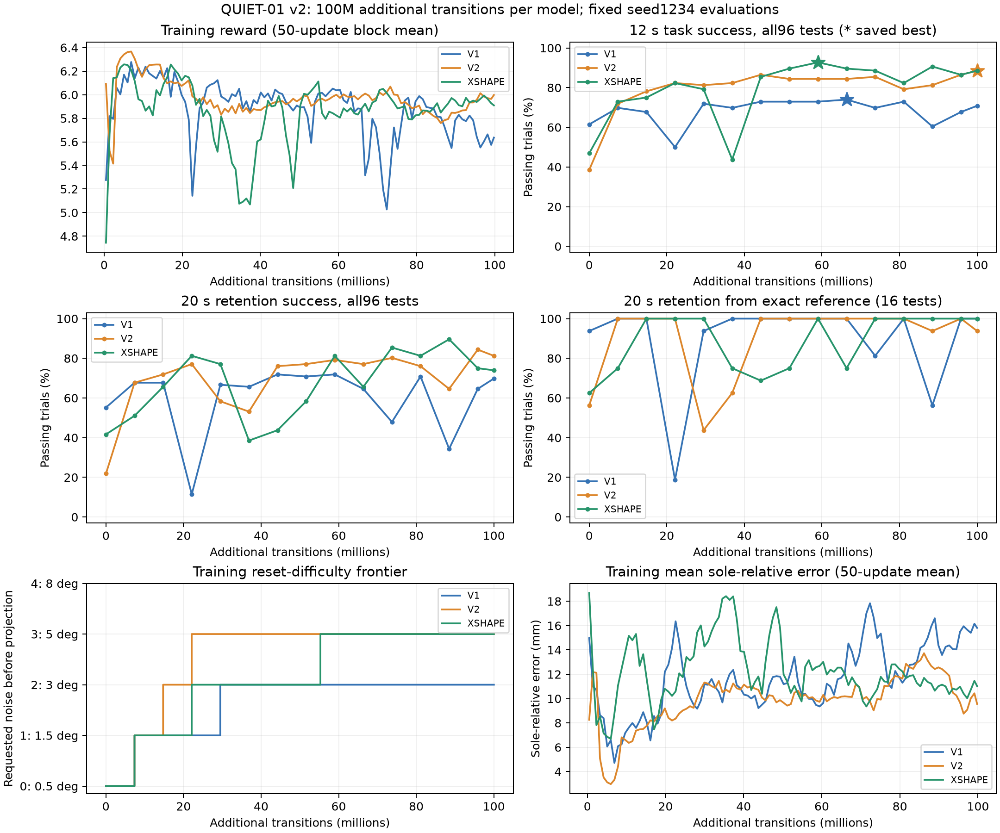

# QUIET-01 v2 completed results

[Best-policy video gallery](quiet01v2-videos.html), [media provenance/status](quiet01v2-media.md).

[Interpretation: what we have and what remains uncertain](quiet01-v2-assessment.md).

Checked23November2026. GPU preflights3263184 and training3263185 all complete exit0.
Each model reaches100,012,032 additional transitions (step limit). No jobs remain running.

| Model | Baseline /96 | Best /96 | Final /96 | Best step (M) | Reference /16 | Reference retention /16 | Runtime |
|---|---:|---:|---:|---:|---:|---:|---:|
| V1 | 59 | 71 | 68 | 66.36 | 16 | 16 | 4.38 h |
| V2 | 37 | 85 | 85 | 100.01 | 16 | 15 | 5.95 h |
| XSHAPE | 45 | 89 | 85 | 58.98 | 16 | 16 | 5.02 h |

Best selection optimizes the12s return task with quiet-reference qualification.
Reference retention means the separate20s test, including its final five-second quiet window.
Both tests use the same initial-pose test split and sensor-noise seed1234.

V2 and X-shape improve substantially on these tests. All selected policies pass16/16
quiet-reference return trials. Harder initial deviations remain less reliable:
the hardest requested8deg bank passes4/16(V1),7/16(V2),11/16(X) at the selected checkpoints.
Requested angles are projected onto feasible poses; they are not achieved motor RMS deviations.
Final training frontier is level2(V1,3deg requested) and level3(V2/X,5deg requested).

X-shape has the best saved return score, but its final score is lower than its earlier best.
V1 also ends below its best. These single-seed runs do not prove convergence or general
robustness. There are no pushes or initial-velocity disturbances in this experiment.
No non-finite values occur in logged reward, KL, value loss, estimator loss or posture-error
diagnostics. The disabled push-gate metric intentionally remains NaN and is not a loss.

[Numeric summary](data/quiet01v2/results/summary.csv),
[complete summary](data/quiet01v2/results/summary.json). Raw progress, evaluations,
probes, preflight receipts and best/final checkpoints are archived under
`report/data/quiet01v2/results/`. Individual plots:
[V1](figures/quiet01v2_v1_convergence.png), [V2](figures/quiet01v2_v2_convergence.png),
[X-shape](figures/quiet01v2_xshape_convergence.png).

Historical hold diagnostic3263170 also completed; see
[the v1 hold diagnosis](quiet01-hold-diagnosis.md) for its independently labeled controls.
No new training or video-generation jobs were submitted in this status check.
