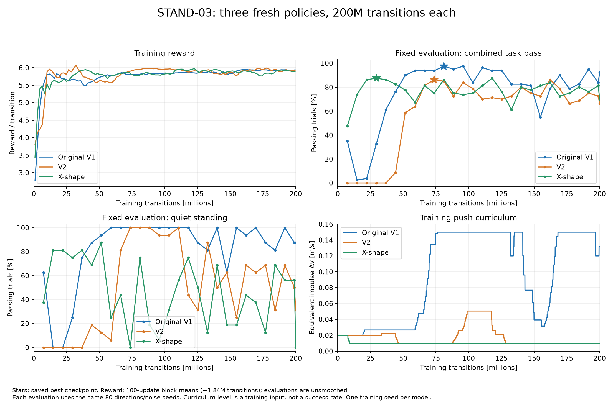

# STAND-03: three-model standing results

Checked **10 November 2026**, Europe/Zurich. All three training tasks in array
**3246822** completed successfully (exit 0:0), each at **200,005,632 transitions**.
All three prerequisite GPU preflights passed. No additional training was launched.

[Videos and graphs](standing03-videos.html) ·
[comparison PNG](figures/standing03_convergence_comparison.png) ·
[comparison PDF](figures/standing03_convergence_comparison.pdf) ·
[raw scheduler receipt](data/standing03/results/scheduler.txt).

| Model | Scheduler duration | Saved best step | Best task pass | Final task pass | Best full-duration trials |
|---|---:|---:|---:|---:|---:|
| Original V1 | 7h11m14s | 81.10M | 78/80 (97.5%) | 74/80 (92.5%) | 78/80 |
| V2 | 9h33m12s | 73.73M | 69/80 (86.25%) | 53/80 (66.25%) | 73/80 |
| X-shape | 9h30m43s | 29.49M | 70/80 (87.5%) | 56/80 (70%) | 80/80 |

The best policy is the saved `best` checkpoint selected by the fixed evaluation
score during training. It is different from `final` for all three models.
Scheduler duration includes startup; `completion.json` records training-loop time.
The X-shape mass estimate is provisional. The original has a continuous sole;
V2 and X-shape each have two separated pads per foot. Foot contact is scored
from actual load, with the same standing reward and planted-foot rules.

## Archived evaluation of the best checkpoints

Each column contains **16 first-episode trials**, 20 seconds, full sensor noise,
nominal plant, seed 1234. Pushed trials use 16 evenly spaced horizontal directions,
one 100 ms force pulse at five seconds. Equivalent impulse Δv is normalized by
robot mass; it is not a walking target speed.

| Model | Quiet / no push | 0.02 m/s | 0.05 m/s | 0.10 m/s | 0.15 m/s |
|---|---:|---:|---:|---:|---:|
| Original V1 | 16/16 | 16/16 | 16/16 | 15/16 | 15/16 |
| V2 | 16/16 | 16/16 | 16/16 | 12/16 | 9/16 |
| X-shape | 12/16 | 16/16 | 15/16 | 15/16 | 12/16 |

**Task pass and survival are different.** Every passing trial completes 20 s
without physical fall or planted-foot violation. Quiet trials additionally need
a five-second quiet streak at the end of evaluation. Pushed trials need a
five-second quiet streak starting within two seconds after the pulse. A
successful pushed trial does not need its *last* five seconds to be quiet.
The legacy `survival` mapping stores these task pass rates; the explicit
`full_duration_fraction` stores full duration separately.

This asymmetric time window means a pushed trial can pass while a no-push
trial with similar late movement fails. The X-shape best checkpoint completes
all 80 trials, but ten miss the settling criterion. Its lower pass score does
not imply ten falls. This scoring detail needs to be considered before making
a stronger robustness comparison.

## Learning curves

Training rewards approach similar levels around 5.8–6.0, while fixed evaluation
still varies. All three final policies score below an earlier saved best.
The reward plateau therefore does **not** establish stable task convergence or
justify assuming that more steps always improve balance. V1 achieves the strongest
score in this single-seed campaign. V2 and X-shape training push levels retreat
to the minimum while their dense reward remains high.

The per-model figures include episode duration, each push level, full-duration
survival versus task pass, curriculum, sensor noise and separate reward terms:

- [V1 learning curves](figures/standing03_v1_convergence.png)
- [V2 learning curves](figures/standing03_v2_convergence.png)
- [X-shape learning curves](figures/standing03_xshape_convergence.png)

Reward and reward-term curves use nonoverlapping 100-update means (~1.84M
transitions). Evaluation points are raw and unsmoothed. The training push level
is an input to training, not a measured robustness threshold. Repeated fixed
directions/seeds help compare checkpoints, but they are not a held-out test set.
One seed per model and different masses/geometries limit design-level conclusions.

## Videos and reproducibility

Replay array **3247563** reloads each selected best checkpoint and its observation
normalization using the frozen training code, with no learning. It repeats the
80-trial evaluation and retains all outcomes. Video trials **0** (quiet) and
**48** (+X, 0.10 m/s-equivalent pulse) were fixed before simulation for every model.
Both independent trials appear side by side at 1× speed for 20 seconds. Any early
termination freezes the last pre-terminal pose with an explicit warning, without
showing an automatic reset. Anatomical left/right feet are colored blue/orange
only for rendering. Videos use native MuJoCo to display recorded MJX states;
they do not resimulate the policy on a different physics backend.

Independent GPU replays completed successfully: **78/80, 69/80 and 70/80** for
V1, V2 and X-shape respectively. V1/V2 reproduce every archived level's pass
count. X-shape has the same total, with quiet standing changing **12/16 → 13/16**
and the strongest push changing **12/16 → 11/16**. That small per-level replay
discrepancy remains unexplained; do not imply bitwise reproduction.

The preselected quiet trial completes and passes for every model. The preselected
+X 0.10 m/s trial completes and passes for V1 and X-shape; **V2 falls at 6.50 s**
(also violating the planted rule). That failure is explicitly shown in its
video, despite recording the saved best checkpoint. A representative fixed trial
was not replaced with a favorable direction after inspecting outcomes.

Independent replay results and video metadata are saved in each model's
`replay.json` and `video-provenance.json`. The HTML gallery reports the replay
score beside the archived score. Graph inputs, checkpoints, configs, outcomes,
logs, CSV tables and hashes are retained under
[report/data/standing03/results](data/standing03/results/).
